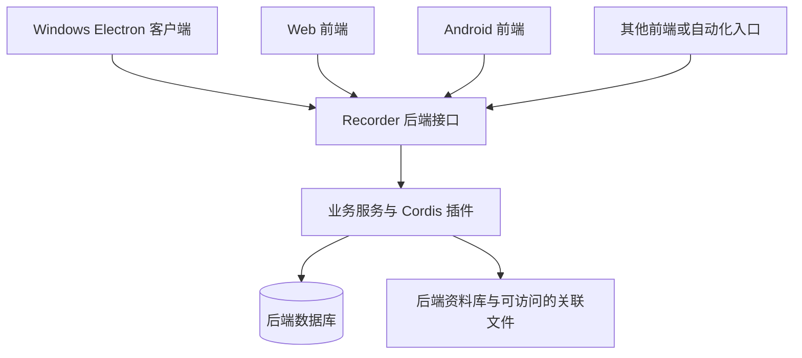

# Recorder 后端与客户端职责

状态：已确认的架构方向，含待定的接入细节。更新日期：2026 年 10 月 25 日。阅读时机：后端、客户端、存储、通信与插件相关工作。

Recorder 的业务后端当前以 TypeScript + Node.js 面向 Windows/Linux 运行，未来也可由 Android 等本地设备承载，不强制 PC 或服务器常驻。任意前端通过能力接口访问后端，业务规则与持久化仍在后端能力层，详见 [本地宿主与同步演进](local-runtime-sync.md)。前端、后端及功能模块全部采用 Cordis 现有机制，边界见 [全面插件化](plugin-everything.md)。Windows 使用 Electron，共享界面使用 Vue 3 + TypeScript + Vite；Android 使用 Capacitor + Vue，按需 Kotlin。

## 职责划分

| 部分 | 职责 |
| --- | --- |
| 前端 | 显示界面、接收交互、提交请求、显示后端结果及连接或传输状态 |
| 后端 | 校验和执行业务操作，管理记录、文件、分类、检索、提醒、统计、AI 与业务插件 |
| 后端存储 | 保存结构化数据与托管文件；外部关联文件由后端按实际可访问性处理 |
| 设备接入适配 | 以插件在相应设备取得用户选择的输入，或调用系统展示接口；具体契约按功能细化 |
| Android 本地能力 | 远端模式保留待提交队列目标；未来本机后端模式可以处理正式业务，宿主与同步实现另行验证 |

“前端只负责 UI”在业务上的约束是：前端不维护另一套记录处理、分类、统计或调度规则。输入校验和权限判断仍需由后端负责，不能只依赖界面。

## 部署关系

图中的后端可部署在用户 PC、局域网中的设备或远程服务器。同一部署可供多个客户端访问。客户端是否提供后端地址切换、桌面安装包是否附带本机后端，尚未确定。

同一后端先供用户自己使用，保留以后增加账号的空间。HTTP/REST + OpenAPI + SSE、本地账号与后端可撤销会话已确认，范围见 [API 与认证主线](api-auth-baseline.md)。三端的凭据适配和设备登记模型继续按 [身份与多设备设计](../../design/security/identity-device-access.md) 细化。

后端在本机且可运行时，同机访问无需互联网；后端在远程设备时，客户端必须能够连接该设备。部署在 PC 上时，该 PC 关闭会使对应服务不可用；部署在远程服务器上时，本地 PC 关闭不影响其他客户端访问仍在运行的服务器。

## 设备采集边界

远程服务器不能仅凭一次 API 请求直接取得另一台设备的系统剪贴板或未上传的本地文件。快捷键、托盘、粘贴、文件选择和系统分享，需要在有这些能力的设备侧接入。

设备接入适配取得用户明确选择的内容并传给后端，后端再决定怎样记录、保存和组织。这种适配不承担独立业务后端。具体模块与通信的待定提案分别见 [Electron 协作设计](../../design/architecture/backend-electron-boundaries.md) 和 [Android 协作设计](../../design/architecture/backend-android-boundaries.md)，不因此修改“业务全部由后端处理”的原则。

以临时中转为例，候选流程为：用户主动放入内容 → 设备侧取得文本或文件 → 传到后端 → 后端保存并返回结果 → 前端展示。读取现有截图或录制文件，不等于当前已经要求 Recorder 自带截图或录屏工具。

## 文件存放与关联

默认托管模式下，文件进入后端资料库。文件与后端在同机时可讨论本机导入；位于不同设备时需要上传。前端只提交本地路径不能完成跨设备文件保存。

只关联原文件仍是用户期望的选项，需要区分：

- 文件位于后端设备或后端实际可访问的存储上，可进一步设计引用及失效处理。
- 文件仅存在于客户端设备时，如何长期引用和取用仍未决定；不能自动视为后端已经保存或能够打开。

传输中的内容与后端已确认保存的内容，应在界面上区分。Android 收集暂存与连通后自动重试已确认，队列和文件的具体实现继续设计；本地只保留待提交材料及传输状态，不维护独立业务资料库。Windows/Web 的断线暂存仍待讨论。

记录支持多个标签及多个分层分类归属，删除先进入可恢复的回收站，清空时再确认彻底删除。数据模型已选统一记录基础、独立附件、标签分类关联和插件业务表，范围见 [数据模型主线](../storage/data-model-baseline.md)。[数据访问主线](../storage/data-access-baseline.md) 已确认 Drizzle、Kit 与后端统一迁移协调；[模型细化](../../design/storage/data-model.md)、[存储生命周期](../../design/storage/storage-lifecycle.md) 及 [迁移机制](../../design/storage/plugin-migrations.md) 中的具体实现仍为提案。

## 提醒与同步

提醒规则和重复安排由后端处理。Android 已确认尽量准点，以及短时断网或 PC 后端关机仍希望已有提醒继续触发的目标。当前提案是后端预先计算具体时刻、手机登记系统定时通知；设备定时属于执行投递计划，不是另建业务调度规则。推送渠道、登记范围和恢复细节尚待确认，见 [Android 协作设计](../../design/architecture/backend-android-boundaries.md)。

多个前端连接同一后端的模式继续保留。用户已补充未来需要各端本地处理和网盘等云同步的可能性，因此不再排除 Android 本地业务宿主；当前尚未实现同步、冲突合并或移动后端。同步协议与备份恢复分别设计，不同步正在使用的 SQLite/WAL 文件。

## 技术选择状态

Windows 已选 Electron，共享界面已选 Vue 3 + TypeScript + Vite，Android 已选 Capacitor + Vue 并按需使用 Kotlin；后端已选 Harness 维护版 Cordis 及配套 Loader、Fastify、SQLite + better-sqlite3。其他选型状态统一维护在 [当前技术状态](../technical-status.md)，本文件不重复候选比较。

后端工作先阅读 [后端技术](backend-stack.md)，界面工作先阅读 [前端技术](frontend-stack.md) 与按需阅读 [Android 方向](android-stack.md)。跨端公共协议集中在 [统一 API 提案](../../design/interfaces/unified-api.md)，本机、局域网与服务器的网络入口见 [部署接入提案](../../design/operations/deployment-access.md)；设备适配再读对应协作提案。实际目录见 [工程目录规划](../development/repository-layout.md)，接口、认证和部署细节仍待确认。返回 [当前文档索引](../README.md)。
