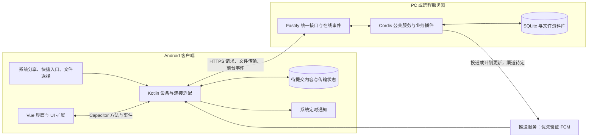

# Recorder Android 与 Cordis 后端协作设计

状态：Capacitor + Vue、按需 Kotlin 原生能力，以及收集暂存与提醒体验目标已确认；公共 API 和认证按 [已确认主线](../../current/architecture/api-auth-baseline.md)。本文模块、具体契约和接口名称仍为提案，尚未实现。更新与官方资料核对日期：2026 年 10 月 24 日。

阅读时机：设计 Android 快速收集、分享接收、后台提交、通知和后端接入时。先读 [Android 当前方向](../../current/architecture/android-stack.md) 和 [架构概览](../../current/architecture/overview.md)。公共协议见 [统一 API](../interfaces/unified-api.md)，登录和队列归属见 [身份与多设备](../security/identity-device-access.md)，PC/LAN/服务器地址与 HTTPS 见 [部署接入](../operations/deployment-access.md)。本文侧重 Android 适配；比较桌面边界时再读 [Electron 协作提案](backend-electron-boundaries.md)。

## 1. 推荐的协作结构

范围更新：本提案描述 Android 连接远端实例的模式。用户已新增 [Android 本地后端与云同步方向](../../current/architecture/local-runtime-sync.md)，后续也可连接本机宿主；下文不再作为禁止手机本地业务处理的依据。两种模式的具体适配仍待实现，真机验证暂缓。

这里的“原生模块”是职责划分，不要求每项都建立一个独立进程或 npm 插件。普通显示继续复用 Vue；不依赖页面存活的收集提交、文件读取和通知处理由 Android 侧承接。手机原生服务和系统任务也不能被当作永不退出的常驻进程。

## 2. 模块边界

| 模块 | 所在位置 | 职责及边界 |
| --- | --- | --- |
| 轻量收集页、资料管理页、UI 扩展 | Vue | 输入、预览、确认、查看状态；表单提示不能代替后端校验 |
| 入口适配与导航 | Android | 接收分享 Intent、快捷方式与通知点击；整理为受控的入口数据，唤起对应页面 |
| 采集与文件适配 | Android | 读取用户选中的文本和 URI、取得附件快照、返回可用的输入句柄；不自行分类或创建正式业务记录 |
| 待提交队列 | Android | 保存用户确认提交的内容、附件和状态，管理重试及结果核对；不是后端业务库的镜像 |
| 连接、会话与传输 | Android，推荐 | 统一当前后端与会话，执行小请求和文件传输，供 UI 与后台任务共同使用 |
| 提醒设备适配 | Android | 权限状态、推送注册、后端计划的系统登记与取消、通知显示和点击路由；不计算业务重复规则 |
| API 门面 | Fastify | 身份校验、参数校验、版本与能力发现、文件通道、事件出口；调用明确公开的服务 |
| 收集、附件与记录服务 | Cordis 后端 | 接受收集提交、幂等核对、校验附件归属、事务提交并返回正式记录标识 |
| 日程／待办／订阅等业务插件 | Cordis 后端 | 解释业务意图、执行规则、计算下一次提醒与重复计划 |
| 提醒计划与投递服务 | Cordis 后端 | 持久化计划版本、设备投递状态、推送任务与重试，处理变更和撤销 |

手机得到的是“输入材料”和“待执行请求”；后端保存后才形成正式记录。客户端可以做格式提示、预览和传输完整性检查，业务有效性、权限与最终保存仍由后端判断。

## 3. 通信方式与契约

### UI 与 Android：方法、快照和事件

建议共享 UI 面向统一业务客户端和设备接口。Android 适配通过 Capacitor 调用原生方法；后续再确定方法名和 schema。可表达的操作包括：获取待收集内容、确认入队、查看队列、重试、检查通知能力、打开授权设置，以及按已知业务操作提交请求。

事件只携带输入标识、任务进度、状态和记录标识。Vue 启动或恢复时先查询快照，再接收增量事件，并用状态版本去重；不能依赖原生层只广播一次。UI 取消订阅或被销毁，不自动取消用户已确认的提交任务。Capacitor 提供原生方法与事件机制；队列持久化、就绪交接和恢复语义需要 Recorder 自己定义。[Capacitor Android 插件](https://capacitorjs.com/docs/plugins/android)

桥接使用已批准的操作、句柄和目标后端，不向 UI 扩展开放任意本机路径读取或任意 URL 的带凭据请求。新增原生能力随 Android 应用更新；后端插件发布不能自动增加 Manifest 权限或新的原生代码。

### Android 与后端：同一业务 API，原生层协调会话

建议 Android 由原生连接模块协调请求和会话，因为采集自动重试与提醒更新必须能脱离 Vue 页面运行。共享 TypeScript 界面仍保留相同的业务调用接口，Android 仅替换传输适配；Kotlin 不重写业务规则。

小型 JSON 请求可复用现有原生 HTTP 能力，在 Recorder 适配层施加后端和权限边界。CapacitorHttp 支持原生请求，但不自动提供持久重试队列、统一认证或 SSE 实现，不能仅打开 fetch 替换选项就认为上述职责已完成。[Capacitor HTTP](https://capacitorjs.com/docs/apis/http)

| 内容 | 推荐通信 | 需要约定的语义 |
| --- | --- | --- |
| 查询、普通业务操作 | HTTP/REST，配合 OpenAPI；远程使用 HTTPS | 身份、输入输出、错误分类、版本及插件能力 |
| 采集提交与结果核对 | HTTP + 稳定采集标识 | 重试返回同一操作结果，不能重复创建记录 |
| 附件上传与下载 | 独立 HTTP 文件通道，原生流式读写 | 上传会话、附件完成状态、归属与大小校验；续传协议另定 |
| 前台记录变化与能力变化 | SSE，恢复后重新查询；原生客户端实现待选 | 事件是更新线索；不能靠它保证手机后台投递 |
| 推送设备注册 | 已认证的 HTTP 请求 | 后端实例、当前用户、安装实例、渠道与 token 轮换 |
| 提醒计划下发与设备回执 | HTTP 拉取计划和提交登记结果；在线事件或推送提示刷新 | 计划版本、时间范围、登记/取消状态；不把登记成功记作用户已读 |

若选择前台 WebView 直接请求，也可实现，但需额外协调浏览器跨域、Cookie/token 与后台原生任务的会话；当前更倾向统一的原生连接适配。认证专题建议由 Kotlin 会话模块持有独立 Bearer 凭据，统一协调前台与后台任务的续期和退出。实际 HTTP/SSE 库、认证组件、生成客户端方式仍待确定，不将 TypeScript 类型定义当作 Kotlin 的运行时校验。

连接配置应绑定后端实例与账号。Android 中的 localhost 指手机自身，连接 PC 应使用手机可达的地址。切换账号或后端后，旧队列暂停并保留原归属，不能静默改投新目的地；新凭据不能随意用于上传重定向后的其他主机。推送 token 只是投递地址，不是业务登录凭据。

## 4. 快速收集与接收分享

建议把分享入口、快捷方式、可选快速设置磁贴和应用内新增统一导向轻量收集流程。页面资源随安装包提供，打开入口不等待远程页面或整库查询；保存动作仍需后端处理。具体快捷入口清单继续按使用习惯细化，不默认增加悬浮窗、无障碍服务或持续后台剪贴板监听。

接收分享需声明 ACTION_SEND / ACTION_SEND_MULTIPLE 和相应 MIME 类型，读取文本与附件，处理冷启动及已运行 Activity 接收新 Intent。Capacitor 官方 Share API 用于向外分享，接收层需要另外接入。传入类型与内容可能不一致，不能直接信任；复杂文件读取移出 UI 线程。[Android 接收分享](https://developer.android.com/develop/ui/compose/sharing/receive) · [Capacitor Share](https://capacitorjs.com/docs/apis/share)

建议流程：

1. 原生入口取得内容，创建本次收集标识，向轻量 Vue 页面提供文本、名称、类型、大小和附件句柄。
2. 用户确认收集后，原生层将文本、目标后端/账号、操作意图和附件保存到应用私有的持久暂存区。需要抢在 URI 授权失效前读取的内容，可先放入明确受管理的未提交输入区；用户取消时回收。
3. 内容确实可恢复后，界面显示“已暂存到手机，尚未保存到后端”。文件仍在复制、空间不足或无法读取时，不能显示暂存成功。
4. 队列尝试连接后端，上传附件并提交收集请求。Vue 页面关闭后，由原生任务继续处理或等待系统允许重试。
5. 后端完成保存与附件关联，返回记录标识。设备持久化该结果，再显示“已保存到后端”，按清理规则回收可安全删除的暂存副本。

默认建议把待传文件复制为稳定的应用私有副本，而不是长期只保存来源 URI。分享授权可能是临时的；文档选择器也只有在提供相应授权时才可持久取得访问权。单个手机 URI 不会让 PC 或远程后端读到内容。[分享文件授权](https://developer.android.com/training/secure-file-sharing/request-file) · [文档访问授权](https://developer.android.com/training/data-storage/shared/documents-files)

用于保证待提交内容不丢失的文件不能仅放在系统可随时清理的 cache 目录。建议使用应用私有持久目录和可恢复的队列索引；具体采用 Room、其他 SQLite 方案或文件索引尚未选定，后端的 better-sqlite3 不因此进入 Android。附件与队列索引分步写入时需能恢复中断状态，未完成复制不得变成可提交任务。

## 5. 自动重试、幂等与失败状态

| 状态 | 用户看到什么 | 行为建议 |
| --- | --- | --- |
| 准备输入 | 正在读取或复制 | 还不能保证跨退出恢复，不提交不完整附件 |
| 已暂存／等待连接 | 尚未保存到后端 | 保留输入，等待网络及后端恢复；提供手动重试 |
| 正在传输或提交 | 进度与当前阶段 | 原生任务执行，不绑定页面生命周期 |
| 结果待核对 | 请求可能已保存，正在确认 | 查询相同采集标识的结果或用相同幂等标识重试 |
| 需要处理 | 登录失效、插件不可用、内容校验失败等 | 保留原输入，给出可操作原因；不无休止重试永久错误 |
| 后端已保存 | 记录标识和保存结果 | 保存本地回执，再按规则回收暂存 |

自动重试建议基于 Android 可持久调度的任务，设置网络条件和退避；网络可用不代表 PC 后端可达。可中断传输与延后重试优先评估 WorkManager；用户主动的大文件长传输可按 Android 版本评估 UIDT 等机制。具体任务类型与兼容实现尚未锁定，系统调度也不能承诺网络恢复瞬间必然执行。[WorkManager 重试](https://developer.android.com/develop/background-work/background-tasks/persistent/getting-started/define-work) · [用户发起的数据传输](https://developer.android.com/develop/background-work/background-tasks/uidt)

大附件由原生层直接流式传输，只向 JS 传递进度和句柄，避免整个视频经过 Base64 桥接。普通原生 HTTP 或文件插件调用本身不保证跨进程回收恢复；持久任务、上传状态和服务端协议必须配合。

建议采集标识在本次确认入队时固定，绑定后端实例、用户与请求内容版本。后端保存标识、内容摘要和结果；同标识同请求返回原结果，不同请求返回冲突。幂等记录的保留期必须覆盖可能的长时间离线重试，不能只用进程内去重或短时间缓存。客户端超时不代表服务端未保存。

附件先进入后端上传暂存区，完成后由收集服务校验并关联；数据库事务不自动包住文件写入，需要文件就绪标记、可恢复的提交过程和孤立暂存清理。业务记录提交后才发布记录变化；持久投递任务可与记录变更在同一数据库事务中登记，再异步执行。

取消一个尚未发送的任务可停止提交；已发出的请求可能已经在后端完成，不能显示为“已撤销保存”。已开始提交的内容修改应另有版本或后端编辑语义，不能改写原幂等请求。暂存容量、保留时间、编辑/取消交互仍待确定；未提交资料不按无关缓存策略自动淘汰。

## 6. 提醒计划：后端计算，手机登记

用户要求尽量准点，并希望短时断网或 PC 关机时已有提醒继续触发。因此建议以**提前登记到手机的系统定时通知**承担已知日程，推送承担计划变化提示和适当的补充投递。仅在到期时由 PC 发推送无法覆盖 PC 已关机的场景。

后端业务插件计算具体触发时刻，提醒计划服务生成设备可执行的条目。候选字段包括后端/用户/设备归属、业务记录与插件标识、提醒发生实例标识、计划版本、UTC 触发时刻、显示时区、通知摘要及打开目标。手机不根据“每月续费”自行推算下一次发生时间。

建议流程：

1. 后端创建或修改日程，持久化未来一段时间内的具体提醒与版本。
2. 手机连接时拉取计划及撤销信息，原生层持久保存、检查能力，向系统登记或取消，并回报实际成功/失败状态。
3. 到期由 Android 系统触发通知，不等待 Vue、SSE、网络或后端临时计算。
4. 点击通知打开对应记录；有网络时查最新状态。无网络时可显示已有提醒摘要和连接状态，不把提醒摘要当作完整离线业务记录。
5. 重新连接或恢复前台时对账计划、权限与登记状态，补足后续时间范围。重启后需在系统允许时从已保存计划恢复登记，具体插件能力须验证。

计划登记范围、刷新时机和过期提示还需决定，不能暗中只准备很短时间却宣称长期离线可用。后端新建但尚未下发的提醒不会离线触发；离线手机也可能继续显示尚未收到撤销的旧提醒。设备时钟变化、时区调整和业务重复计算仍需后端计划版本配合。

Capacitor Local Notifications 可作为接入起点；精确时间、权限变化和后台更新需要结合选定版本核验。Android 的普通通知授权与精确定时授权分开处理，普通非精确闹钟不能承诺几分钟内到达。能力不足时明确展示“未登记”或“可能延迟”，不能把降级结果记作准点保证。[本地通知](https://capacitorjs.com/docs/apis/local-notifications) · [Android 闹钟机制](https://developer.android.com/develop/background-work/services/alarms)

## 7. 推送、回执与去重

Google Play 服务可用使 FCM 成为优先验证候选，尚未确认具体渠道和 SDK 版本。推送注册绑定安装实例和当前身份，token 更新后重新登记；注销、换账号和设备移除需停用相应投递目标。

计划变更推送是刷新线索，仍需通过已认证 API 获取计划；推送丢失后靠重连对账补齐。后台处理放在 Android 接收服务及受系统管理的任务中，不依赖 Vue 回调。Capacitor 的 data-only 推送在进程已终止时不会调用其 JS 接收事件，自定义处理需原生接入。[Capacitor 推送边界](https://capacitorjs.com/docs/apis/push-notifications)

建议按同一个“提醒发生实例 + 设备 + 版本”管理本地登记与推送补充。已确认本地登记的设备优先走本地提醒；未登记或不支持的设备可按规则尝试推送。手机记录已展示的发生实例，能自行展示的路径进行去重。登记回执与实际展示、点击、已读是不同状态。

自动展示的推送不能假定先经过 JS 去重；不同 FCM 消息类型和 API 版本有不同前后台行为，需在确定 SDK 后选择相应策略。推送回调内也不执行耗时下载。网络和系统状态使端到端“绝不重复、绝不遗漏”无法仅靠一张去重表保证，应通过同标识、更新替换和状态对账尽量减少重复。[FCM 接收机制](https://firebase.google.com/docs/cloud-messaging/android/receive-messages)

通知中的“完成”“延后”等动作如要改变业务，仍提交后端处理；本轮没有确认这些操作的离线执行。手机关机、用户强行停止应用、权限关闭或计划尚未登记时，不承诺一定触发。

## 8. Cordis 插件协作及停用行为

收集、文件、身份、设备、提醒计划和投递可以组织为 Cordis 公共服务／基础插件，业务插件按现有依赖与 effect 机制使用它们。模块边界先按职责定义，不急于固定一项服务对应一个发布包。后端公开能力仍经固定 Fastify 入口和受管理的操作注册表访问，不把整个 Context 直接远程暴露。

例如订阅插件负责续费规则，公共提醒服务负责保存具体计划，设备投递适配负责通知手机；Vue 插件负责订阅页面，Kotlin 模块负责系统提醒。业务插件不直接掌握任意手机文件访问或通知系统权限。

插件停用应撤回新操作入口，处置在途调用并将待处理任务置为明确状态；已经保存的数据不自动删除。手机队列遇到目标业务能力不可用时保留输入并提示，不能无声改投另一种业务。后端可生成提醒撤销并在客户端连接后下发，但 Cordis 卸载回调无法立即撤回离线手机已登记的系统通知。这与普通订阅清理不同，需要业务层明确版本和撤销语义。

## 9. 工程归属与后续验证

工程目录见 [目录规划](../../current/development/repository-layout.md)：后端逻辑归 backend，Android 壳与 Kotlin 接入归 android，通用 Vue 组件与客户端契约归 shared。shared 不引用后端数据库或业务插件实现。目录独立不要求复制整套 UI，也不要求各自拥有业务服务。

待细化项包括认证、HTTP/SSE 客户端、队列存储、文件规模与续传、暂存保留规则、提醒提前登记范围、通知权限引导、多设备投递偏好和推送消息策略。已确认的暂存与准点体验目标不再反复作为是否需要的问题。

实现阶段应验证：冷/热启动接收分享、URI 失效与空间不足、复制中断、页面退出和进程回收后恢复、提交成功但回包丢失、后端长期不可达、账号切换与插件停用；提醒覆盖提前登记、PC 关机、短时离线、重启、改期取消、权限撤销及重复通知。本轮只完成文档与官方资料核对，没有执行这些运行测试。

返回 [设计索引](../README.md) 或 [文档总导航](../../README.md)。
