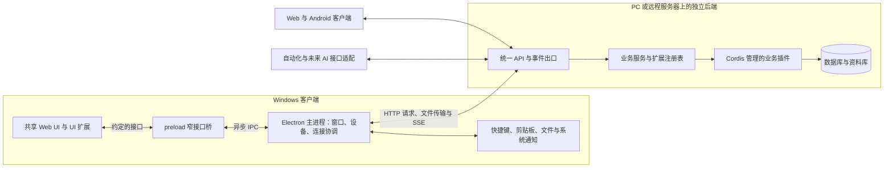

# Recorder Cordis 后端与 Electron 协作设计

状态：技术主线已确认；完整通信与扩展契约仍为提案。基础插件、诊断 IPC 与 UI 已开始实现，范围见 [工程基线](../../current/development/engineering-baseline.md)；不能把本文全部模块视为已完成。更新日期：2026 年 10 月 25 日。

阅读时机：设计或实现后端与桌面连接、插件接口、文件输入输出。本文落实 [当前架构](../../current/architecture/overview.md) 的集中后端方向；技术状态见 [当前选型](../../current/technical-status.md)，后端依赖看 [已确认后端技术](../../current/architecture/backend-stack.md)，UI 工作看 [已确认前端技术](../../current/architecture/frontend-stack.md)。需要追溯 Electron 理由时再读 [历史比较](../../history/research/windows-client-comparison.md)。选定框架不自动冻结接口细节。

跨端公共契约现集中在 [统一 API](../interfaces/unified-api.md)、[身份认证与多设备](../security/identity-device-access.md) 及 [部署接入](../operations/deployment-access.md) 专题提案。本文侧重 Electron 的进程、设备与 UI 配合，相关协议摘要应与这些专题保持一致。

## 1. 总体边界

建议把 Windows 客户端分成界面与设备宿主，Cordis 后端作为独立服务。Electron 的主进程、preload 和渲染进程承担不同职责；preload 是渲染进程中的桥接脚本，不是第四个独立进程。[Electron 进程模型](https://www.electronjs.org/docs/latest/tutorial/process-model)

图中连接方式是推荐方案。即使后端与 Electron 在同一台 PC，也保持相同业务 API；不要让桌面端直接读数据库，或导入后端插件对象来绕开服务边界。桌面安装包是否附带后端及如何启动它，属于单独的部署选择。

建议桌面先加载随客户端分发的受控 UI，再连接指定后端。后端地址与 UI 代码来源分开管理；连接远程服务不意味着直接把其任意网页加载为具备设备接口的应用界面。后端的运行生命周期也与窗口分开：关闭管理窗口不默认停止其他客户端依赖的服务。

## 2. 模块职责与状态归属

| 模块 | 负责什么 | 边界 |
| --- | --- | --- |
| Cordis 运行与加载层 | 插件配置、依赖注入、启停及受管理资源清理 | 沿用选定 Cordis 与 Loader，不自建另一套插件加载生命周期 |
| 后端公共服务 | 身份与访问控制、记录、附件、存储、任务与事件等共享能力 | 模块边界是逻辑划分；哪些作为基础 Cordis 插件实现，后续确定 |
| 后端业务插件 | 日程、待办、开销、订阅、AI 整理，以及后期临时中转规则 | 通过公共服务合作；负责业务校验、持久化与业务状态转换 |
| 后端 API 门面 | 身份校验、请求解析、调用已公开的业务操作、文件传输与事件投递 | 不把任意 Cordis 服务方法自动公开为远程接口 |
| Electron 主进程中的设备宿主 | 托盘、全局快捷键、窗口、剪贴板、文件选择、原生拖出、系统通知 | 取得输入或执行展示动作；不自行决定分类、重复周期、统计或保存规则 |
| Electron 连接与传输模块 | 当前后端会话、请求、在线事件、上传下载、临时传输缓存 | 建议由主进程协调；大文件流式处理，耗时工作按需交给 worker 或辅助进程 |
| preload | 将少量明确方法和事件暴露给界面 | 不暴露整个 ipcRenderer、Node、任意路径读写或任意 URL 请求能力 |
| UI 壳与 UI 扩展 | 页面、菜单、表单、列表、预览、输入草稿与操作反馈 | 可做即时输入提示；业务正确性与权限仍由后端判断 |

建议区分三类状态：

- **后端业务状态**：记录、附件、标签、提醒规则、插件业务配置、任务结果。以后端持久化结果为准。
- **客户端设备状态**：窗口位置、这台电脑的快捷键绑定、连接配置、设备能力和传输进度。留在设备侧合理，不构成第二套业务后端。
- **短期界面或传输状态**：尚未提交的输入、选中项、临时下载副本。不能标成已保存业务记录。Windows 断线后的持久暂存、跨重启重试仍待用户选择；Android 收集暂存已单独确认，见 [Android 方向](../../current/architecture/android-stack.md)。

主进程协调网络不等于把所有工作都放进主进程同步执行。即时唤起不等待网络或完整资料列表，较重页面按需加载；上传、预览准备和后端 AI 任务不能阻塞窗口响应。

## 3. 通信方式

### Electron 内部：窄接口与异步 IPC

界面通过 preload 调用有明确输入、输出的接口，例如收集当前剪贴板、选择文件、提交业务请求、准备附件拖出、订阅状态变化。请求响应可使用 `ipcRenderer.invoke` 与 `ipcMain.handle`；事件桥只向界面传递约定数据，并提供取消订阅的方法。[Electron IPC](https://www.electronjs.org/docs/latest/tutorial/ipc)

建议启用 context isolation、renderer sandbox，并关闭 renderer 的 Node integration。主进程核验调用窗口与参数；只接受已经允许的设备操作、业务操作标识及输入句柄。操作名称本身不是授权。不要把 `request(anyUrl)`、`readFile(anyPath)` 或任意 IPC 通道当成公共桥接接口。[Context isolation](https://www.electronjs.org/docs/latest/tutorial/context-isolation) · [IPC 调用来源检查](https://www.electronjs.org/docs/latest/tutorial/security#17-validate-the-sender-of-all-ipc-messages)

IPC 主要传递可序列化的元数据、任务标识和状态。DOM 的 File 对象不能直接传给主进程；拖入文件需由受控的设备适配换成输入句柄或准备传输。视频等大文件不应变为一整个 Base64 字符串在界面、preload 和主进程之间反复复制。[IPC 序列化限制](https://www.electronjs.org/docs/latest/api/ipc-renderer)

### 客户端与后端：HTTP 为主，SSE 更新在线状态

| 内容 | 建议方式 | 说明 |
| --- | --- | --- |
| 新增、修改、查询、删除及插件操作 | HTTP API；稳定资源采用 REST，配合 OpenAPI | 本机与远程共用协议，远程采用 HTTPS；权限由后端统一判断 |
| 插件能力发现 | HTTP 获取当前可用功能、版本、输入输出描述及 UI 贡献描述 | 只返回当前身份可用的功能；发现结果不替代每次调用时的校验 |
| 文件上传和下载 | 独立 HTTP 传输通道，按需流式传输 | 业务 API 引用附件标识；大文件、续传与校验细节后续确定 |
| 记录变化、任务进度、插件可用性 | SSE 在线事件流 | 提示刷新或更新显示；不是业务数据唯一来源 |
| 需要持续双向交互的未来功能 | 届时评估 WebSocket | 当前 CRUD、进度与提醒展示无需仅为“实时”就引入它 |

SSE 是服务端向客户端的单向事件机制，标准包含重连和事件 ID，但并不替 Recorder 实现事件持久化与补发。建议先保证重连后可重新查询当前状态；若支持游标补发，过期时回到完整刷新。SSE 也不保证桌面退出或手机后台时通知一定送达。[SSE 标准](https://html.spec.whatwg.org/multipage/server-sent-events.html) · [OpenAPI](https://spec.openapis.org/oas/latest.html)

### Windows 连接由谁持有

推荐 Windows 的业务请求和 SSE 连接由主进程中的连接模块统一持有，再通过 IPC 服务各窗口。快捷收集不依赖管理窗口是否存在，凭据不需要交给各个 UI 扩展，多个窗口也可以共用一条事件连接。代价是增加 IPC 适配和事件分发，必须控制大数据复制与主进程负载。

界面直接使用 HTTP 连接后端也是可行方案，结构更接近浏览器；但在 Recorder 中还要同时解决无窗口快捷收集、多个窗口的连接和设备传输，因此当前更推荐前述主进程协调方式。这是 Recorder 的工程取舍，不是 Electron 的强制规定。

共享 UI 面向一致的业务客户端接口：Windows 使用 IPC 适配，Web 使用 HTTP 适配，Android 已选 Capacitor，原生桥接与连接方案见 [Android 协作提案](backend-android-boundaries.md)。复用接口类型、业务调用语义和 UI，而不要求所有平台使用同一种进程通信。媒体预览另用受控资源通道或限权 URL，不把整个视频塞进 JSON IPC。当前认证提案建议 Web 使用 Cookie、Windows 主进程持有独立 Bearer 凭据；两种入口映射到同一身份服务，具体认证库和期限尚未选定。

## 4. Cordis 与业务插件的边界

Cordis 提供 Context、服务依赖、事件以及受生命周期管理的 effect 等机制。插件声明所需服务，使用这些服务完成业务，并在对应作用域内登记可回收资源。进程间通信、公开 API、UI 贡献描述和设备接口，是 Recorder 在这些机制之上定义的应用契约，不是 Cordis 原生已提供的完整产品功能。[Cordis 入门](https://github.com/deepseek-ai/deepseek-harness/blob/master/docs/cordis-primer.md) · [生命周期与 effects](https://github.com/deepseek-ai/deepseek-harness/blob/master/docs/cordis-tutorial/02-lifecycle-and-effects.md)

建议业务插件明确声明：插件标识与版本、所需服务、可公开的操作及输入输出 schema、访问要求、事件、拥有的数据与迁移规则、可选 UI 贡献。插件之间优先经公共服务协作，避免彼此直接修改私有表和文件。

对网络接口，建议采用“固定 HTTP 入口 + 当前可用业务服务或操作注册表”：

1. HTTP 框架启动时建立固定的资源入口、插件操作入口、发现入口、文件与事件入口。
2. Cordis 插件启用后向受管理的注册表登记操作；API 根据操作标识查找、校验并调用。
3. 插件停用或依赖不可用时撤回登记，后续请求返回明确的不可用状态，而不是访问已经失效的服务对象。

这里的注册表只组织 Recorder 的公开能力，不重复实现插件加载、依赖注入或启停。HTTP 框架已选 Fastify；它限制启动后继续添加路由，不能假设卸载 Cordis 插件就会注销它的 HTTP 路径。固定门面和操作分发仍需细化；需要任意自定义路由时，另定支持回收的适配或重启规则。[Fastify 路由实现](https://github.com/fastify/fastify/blob/main/lib/route.js)

稳定 API 可生成 OpenAPI 客户端。运行时新增插件的操作，还需携带相应 schema 与版本供通用调用层使用；不能声称一次生成的静态 SDK 已完整支持所有未来插件。外部 AI 可通过同一业务接口或后续协议适配调用；同进程 AI 插件可调用同一业务服务，均不绕过业务校验。

## 5. 业务插件、UI 扩展与设备能力如何组合

| 层次 | 运行位置 | 典型贡献 | 新增功能通常怎样交付 |
| --- | --- | --- | --- |
| Cordis 业务插件 | 后端 | 订阅续费计算、分类整理、资料处理、临时中转保存规则 | 在后端安装或启用；客户端通过能力发现得知可用功能 |
| UI 扩展 | renderer 或浏览器 | 页面、菜单、详情卡片、表单、操作入口、预览器 | 声明式界面可由通用 UI 渲染；复杂组件需兼容的前端代码包 |
| 设备能力模块 | Electron 主进程及必要辅助模块 | 读剪贴板、选择文件、拖出、展示通知 | 复用已随客户端提供的能力；新增原生能力一般需更新客户端 |

一个功能可以包含这三类部分，也可以只有其中一类。它们通过共同的功能标识与契约关联，不要求在同一进程运行，也不要求每个功能都带三份代码。例如统计插件可能只需要业务与 UI；自动归档任务可能只需要后端；窗口定位只属于设备侧。

前端静态资源服务也可以作为 Cordis 插件加载，功能包可以配套提供 UI 描述或代码资源；实际界面仍在客户端渲染，设备能力仍由当地的 Electron 等宿主执行。这样可以保留“前端以插件形式提供”的扩展方向，同时保持部署边界清楚。

建议 UI 扩展分两级，逐步设计：

- **声明式贡献**：菜单名称、字段定义、表格列、操作按钮等描述。使用既有 UI 组件组合，适合让新后端插件在旧客户端上提供基础入口。
- **定制组件**：复杂编辑器、可视化和特殊预览。建议早期作为可信模块随 UI 发布；以后若要独立下载，再设计包版本、加载与隔离。后端服务静态资源不代表任意远程脚本应获得 Electron 设备权限。

能力清单建议至少包含：后端 API 与插件版本、UI 扩展契约版本、客户端可用设备能力及版本、功能所需与可选能力。功能可用性由实际后端和当前客户端共同决定。例如剪贴板入口需要 Windows 适配；在 Web 上可降级为粘贴或文件选择，不能假定各端有同等后台权限。

早期个人自用的可信 UI 扩展可共享渲染环境，但扩展自报的 pluginId 不能成为强权限隔离。未来开放不可信第三方代码时，需要另行设计 UI 沙箱与后端执行隔离；Cordis 的依赖作用域和 Electron 的 context isolation 均不会自动隔离所有同环境插件。

后端事件只描述业务变化或受支持的通知请求，不自动授予设备操作权限。剪贴板读取、文件上传等采集应对应本机用户动作或明确启用的采集配置；通知按目标设备和会话投递。

## 6. 两条完整协作流程

### 主动收集剪贴板，存入后期临时中转插件

1. 用户按全局快捷键。Electron 宿主立即唤起轻量收集界面，并通过已有设备适配读取这一次剪贴板。
2. 宿主取得文本、图片或用户复制的文件输入，创建本次输入标识；界面显示取得输入或传输中的状态。
3. 连接模块把文本与元数据提交后端，文件内容走上传通道。收集动作绑定已启用的临时中转业务操作，不能因为后端插件缺失就由本地代存成业务记录。
4. Cordis 业务插件调用记录与附件服务，校验并完成保存。附件上传成功与业务记录完成关联应分开确认；后端要能清理未完成提交产生的暂存附件。
5. 后端返回保存结果与记录标识，客户端才显示“已保存”。其他在线客户端按可见性规则收到变化事件并刷新；临时中转跨客户端可见范围仍待定义。

快捷键映射与一次采集是设备接入，怎样命名、分类、保存和清理是业务。复制文件通常只取得文件引用，原文件随后可能变化或被删除；输入句柄不等于内容快照。实现时需选择即时读取、复制暂存或明确检测失败，不能先显示保存成功。[Electron 剪贴板](https://www.electronjs.org/docs/latest/api/clipboard)

若后端不可达，Windows 界面显示未提交或失败。Windows 是否跨重启保存待上传内容尚未决定；不因 Android 收集暂存已确认而自动扩展到桌面。本流程不引入客户端独立业务数据库。临时中转仍是后期功能，本流程仅用于检验架构边界。

### 将远程附件拖出到资源管理器或其他应用

1. UI 提交附件标识和版本，主进程通过后端确认可访问并准备文件。
2. 传输模块下载到受管理缓存；按后端实例、用户、附件与版本区分副本，并记录是否准备完成。
3. 文件准备完成后，界面允许拖出。用户开始拖动时，主进程用本机有效路径调用 `webContents.startDrag`。不要在 dragstart 之后才开始漫长下载，却假设这次拖动仍能完成。
4. 本地缓存按使用状态与清理规则回收；拖动或目标应用取用期间不能过早删除。普通复制式拖出不删除后端原件，也不默认把外部应用的编辑同步回来。

Electron 的常规文件拖出使用本机文件路径，后端上的路径不能替代它。主进程接收附件或缓存句柄，不应让 UI 任意指定系统路径。客户端缓存只服务传输和取用，不承担业务存储；虚拟文件等更高级方案后续独立评估。[Electron 原生文件拖出](https://www.electronjs.org/docs/latest/tutorial/native-file-drag-drop)

## 7. 提醒与 AI 的配合

订阅插件负责计算续费日期，后端调度服务负责到期判断，通知出口向选定且有权访问的在线客户端投递，Electron 设备适配负责展示系统通知。多端是否都提醒、如何去重、错过提醒如何补发仍需定义。单纯关闭管理窗口可保留托盘宿主接收提醒；退出整个客户端后则不能依赖其 SSE 连接展示通知。

AI 分类插件读取被允许的资料，经后端业务服务提交分类结果，并发出任务进度或记录变更事件。UI 负责展示建议、结果或待确认状态；是否自动应用、外部模型可见范围与撤销规则仍未确定。设备层不运行另一套分类规则，也不因为后端发来一条消息就任意读取本机资料。

## 8. 插件启停、失败与恢复

| 情况 | 建议行为 |
| --- | --- |
| 插件启用且依赖就绪 | 注册业务操作、事件及 UI 贡献描述，发布能力变化；客户端重新计算入口可用性 |
| 依赖丢失或插件停用 | 先停止接收新操作，撤回贡献；按策略等待、取消或交接在途任务；客户端撤销相关入口、订阅及插件专属快捷键 |
| 插件拥有已持久化的提醒或任务 | 调度器检查其处理器是否仍可用，按插件归属暂停或报告不可用；不能继续调用已卸载函数 |
| 插件关闭或升级 | 已保存数据默认保留；数据迁移、卸载后展示和显式删除另有规则 |
| 插件 UI 与客户端不兼容 | 显示不可用原因或使用基础界面，避免留下能点击却无法完成的入口 |
| 网络或窗口重建 | 重新查询业务状态与能力清单，重新建立所需订阅；事件不能作为唯一依据 |

Cordis effect 清理不等于撤回已提交数据库事务，也不保证任意在途异步工作自动安全终止。操作取消、任务交接和数据迁移是 Recorder 需要定义的业务契约。

为避免重试和多客户端操作造成歧义，建议接口带有可追踪的请求或操作标识；写入重试设计幂等语义，修改记录携带版本以检测并发覆盖。网络超时不代表服务端没保存，界面应能查询结果；这些要求不等同于已决定离线队列或多库同步。

## 9. 本轮结论与后续决策

已确认：Windows 使用 Electron；后端采用 Harness 维护版 Cordis 及配套 Loader、Fastify、SQLite + better-sqlite3；业务与数据集中在 PC 或远程服务器。

HTTP/REST + OpenAPI + SSE、本地账号与后端可撤销会话也已确认，范围见 [当前依据](../../current/architecture/api-auth-baseline.md)。推荐但未冻结：独立后端进程、Electron 常驻设备宿主、preload 窄桥接、共享 UI、Windows 主进程协调连接、固定 API 门面配业务注册表、三类扩展分工及能力协商。

接下来宜按实际使用体验继续明确：桌面是否附带本机后端、Windows 断线时未提交输入的保留方式、UI 扩展是否必须独立热安装、多设备提醒偏好，以及本机原文件关联范围。基础依赖已锁定，正式配套和契约继续细化；Android 接入与通知见 [协作提案](backend-android-boundaries.md)，各端工程归属见 [目录规划](../../current/development/repository-layout.md)。实现和测试只以工程基线记录为准。
