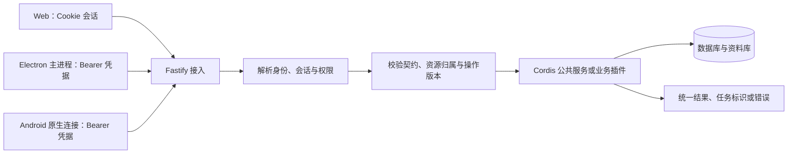

# Recorder 统一后端 API 提案

状态：HTTP/REST + OpenAPI + SSE 已确认；路径、schema、插件分发与配套依赖仍在设计。核对日期：2026 年 10 月 24 日。确认范围见 [API 与认证主线](../../current/architecture/api-auth-baseline.md)。

阅读时机：设计业务接口、客户端 SDK、插件公开操作、文件传输或在线事件时。先读 [当前架构](../../current/architecture/overview.md)；身份与会话见 [认证和多设备](../security/identity-device-access.md)，网络入口见 [部署接入](../operations/deployment-access.md)。本文的路径均为讨论示例，不代表已有服务。

## 1. 推荐组合与理由

已确认 **HTTP/REST + OpenAPI + SSE 在线事件**，推荐配套独立文件通道与插件操作入口。PC 本机、局域网与远程部署共用业务契约，变化的是地址、传输保护和认证载体。

| 部分 | 推荐方式 | 对 Recorder 的理由 |
| --- | --- | --- |
| 稳定业务资源 | REST 风格的 HTTP API | 记录、附件、任务和设备有明确身份，三端及未来自动化均易接入 |
| 契约描述 | OpenAPI 配合统一 schema 约定 | 可以生成文档与客户端，避免 TS 界面和 Kotlin 接入各自猜测字段 |
| 运行时插件扩展 | 固定操作入口 + Cordis 管理的操作注册表 | 插件启停不依赖不断重建 HTTP 路由；允许插件专属命令 |
| 大文件 | 独立 HTTP 上传/下载 | 与 JSON 操作分开，支持流式传输及后续续传 |
| 在线变化 | SSE | 单向变化通知足够覆盖当前列表刷新和任务进度；手机后台通知另走设备投递 |

不把全部业务强行变成一个无类型的 invoke，也不要求每个插件拥有自己的服务器。未来出现复杂双向流或独特查询需求时，再针对具体场景评估其他协议。

OpenAPI 是跨语言 HTTP 契约，不等于一份 TS 类型文件。实际使用的 OpenAPI 版本、JSON Schema 方言、校验器和生成器需要一起验证，不因为标准有更新就直接锁定最新版本。[OpenAPI 官方规范](https://spec.openapis.org/oas/latest.html)

## 2. 一条共同的请求处理路径

同一业务请求进入相同服务，不根据客户端种类放宽权限。请求中的 userId、deviceId、pluginId 不能自行建立身份；有效用户、会话和设备绑定由认证层提供。插件自己的业务校验仍要执行。

共享 Vue 调用统一业务客户端接口：Web 适配浏览器 HTTP，Electron 适配 preload/主进程，Android 适配 Capacitor/原生连接。共享操作语义和数据契约，不要求把浏览器 Cookie、桌面密钥或 Kotlin 网络实现放进同一个代码包。

## 3. 接口分区示例

| 建议入口 | 用途 | 访问边界 |
| --- | --- | --- |
| GET /api/v1/info | 最少量的实例标识、API 兼容范围、可用登录方式 | 可公开用于连接探测；不返回完整插件、账号或配置清单 |
| /api/v1/auth/* | 登录、退出、会话续期与设备授权 | 每个流程分别定义凭据和速率限制，不继承业务接口的默认假设 |
| GET /api/v1/me | 当前身份与允许的操作 | 已认证 |
| /api/v1/records、/captures、/tasks | 资料 CRUD、采集提交、耗时任务结果 | 已认证并检查资源归属 |
| /api/v1/uploads、/files/{id} | 上传会话、附件内容与预览准备 | 上传和读取都授权，不用公开静态目录替代 |
| /api/v1/devices、/reminder-plans | 设备登记、投递目标与计划对账 | 绑定当前账号及目标设备 |
| GET /api/v1/capabilities | 当前账号可用业务能力与 UI 贡献描述 | 已认证，能力发现不能替代执行时检查 |
| POST /api/v1/plugins/{pluginId}/operations/{operationId} | 调用插件公开操作 | 校验权限、契约版本、输入、处理器可用性和数据归属 |
| GET /api/v1/events | 可见资源和能力的变化线索 | 已认证，按账号/设备过滤 |

使用统一大版本前缀是当前建议。新增兼容字段、插件版本、UI 契约版本与 API 破坏性变更应分开管理；不能因升级一个插件就要求所有 API 大版本一起变化。

## 4. 写入、并发与错误语义

- 普通创建返回资源标识及版本；耗时分类或媒体处理可返回 202 与任务标识，结果通过任务查询获得，SSE 只加快展示。
- Android 采集沿用稳定的采集标识和幂等键。建议作用域包括后端实例、认证用户、操作种类和请求内容版本；同键同请求返回原结果，同键不同请求返回冲突。
- 幂等标识不等于 requestId：前者跨重试稳定，后者用于追踪一次网络请求。先校验当前身份与权限，再返回历史幂等结果，不能通过猜键读取其他用户结果。
- 多端编辑建议使用资源版本或 ETag/If-Match 做条件写入，过期版本返回明确冲突，让用户决定如何处理；不静默覆盖另一台设备刚保存的内容。
- 列表使用有上限的分页，查询和过滤条件形成固定契约；设备缓存不成为查询事实来源。

建议错误采用 RFC 9457 的 Problem Details，附稳定的业务 code 和追踪标识；保持 401 未认证、403 无权限、409 业务冲突、412 条件版本不匹配、429 限流等 HTTP 含义。插件暂不可用与输入错误分开表达。重试只用于明确可重试的情况，不对所有写入盲目重发。[RFC 9457](https://www.rfc-editor.org/rfc/rfc9457.html)

幂等记录需持久化，保留范围覆盖 Android 可能的离线提交时间；响应丢失时可按相同采集标识核对。业务事务、附件文件状态和通知任务不天然原子，沿用 Android 提案的分阶段提交与恢复处理。

## 5. 插件如何扩展 API

稳定入口由 Fastify 在启动时登记，Cordis 插件通过公共注册服务贡献操作。候选描述包含插件/操作标识、契约版本、输入输出 schema、所需权限、同步或任务式执行、是否可幂等、事件与可选 UI 描述。

调用顺序建议为：认证 → 入口与大小校验 → 查找当前操作 → 校验插件输入和权限 → 执行业务 → 校验输出并形成统一结果。执行过程中还需检查附件、记录等资源属于当前用户；声明一个 scope 不会自动完成对象级授权。

Fastify 对固定路由的校验不会自动随着 Cordis 操作注册而改变。通用插件入口只校验固定外层结构，操作专属 schema 由受管理的校验器登记和使用，停用时一起撤回；需要自定义路径的插件另外约定重启或适配规则。注册表只管理公开能力，不重写 Cordis 的依赖注入与生命周期。

schema 来自受信任的已安装插件代码，不接受客户端随意上传后直接编译。Fastify 提醒将 schema 视为应用代码；动态校验器必须有版本和清理边界。[Fastify 校验文档](https://fastify.dev/docs/latest/Reference/Validation-and-Serialization/)

OpenAPI 描述稳定资源与通用操作外层。运行时能力清单提供当前插件的 schema 和版本；可以另外生成带版本的文档快照，但不能宣称之前生成的静态 SDK 已自动具有所有新插件方法。通用表单能表达的插件可由已有 UI 渲染，复杂 Vue 组件和新原生能力仍需对应客户端支持。

插件启用、停用、升级时更新能力版本。处理器消失时返回明确不可用状态，客户端刷新入口；在途操作需要自己的完成、取消或迁移策略。插件停用不删除已保存记录，也不能立即撤回离线设备上的提醒。服务端同进程插件拥有宿主进程权限，API 权限清单不会将其变成沙箱。

## 6. 文件与在线事件

上传会话与临时附件绑定当前用户，完成上传不等于正式记录保存。提交时再次核验归属、内容完成状态和关联权限；大文件通过二进制通道流式处理，续传协议和分片参数待定。

下载、Range 读取和预览均经过相同授权。Web 同源资源可使用会话 Cookie；原生客户端由宿主带凭据获取，再给 UI 受控资源句柄。若确需带签名的短时下载链接，应限定文件、用途与时效并从日志脱敏，不把长期访问令牌放入 URL。用户上传的 HTML 等主动内容不直接在带会话的应用源内执行，预览隔离方式另定。

浏览器标准 EventSource 没有任意 Authorization 请求头选项，因此推荐 Web 使用同源 Cookie；Electron/Android 使用能携带 Bearer 的流式 HTTP 实现。不要为了套用浏览器接口而把长期令牌拼入事件 URL。[SSE 标准接口](https://html.spec.whatwg.org/multipage/server-sent-events.html)

事件建议包含事件标识、类别、资源标识/版本、时间和必要的失效提示，避免将整份资料广播到所有设备。建立连接及事件投递均按权限过滤；会话撤销、到期或权限变化时结束或更新连接，不能只在首次连接检查一次。

重连游标、补发窗口和快照版本继续设计；没有可用游标时重新查询当前状态。先查询后订阅也可能漏掉中间变化，应采用订阅后查询并缓冲、或带版本水位的快照对账。SSE 不承担 Android 后台可靠提醒。

## 7. 实现归属与待定项

记录、附件、标签分类和插件存储的候选关系见 [数据模型](../storage/data-model.md)。数据模型不是直接对外暴露的表协议；删除/恢复、关联修改和版本检查应保持明确的 API 语义。

后端 API、认证适配与操作注册服务归 backend；框架无关契约和前端调用接口归 shared；Windows/Android 的连接和凭据适配分别归 desktop/android。业务实现不因生成 SDK 而进入客户端。

待定：完整路径与 schema、OpenAPI/校验器版本组合、分页和并发协议、幂等保留规则、上传续传及事件补发。相关身份和部署选择见本文开头的两份提案。本轮未编写接口实现或运行协议测试。

返回 [设计索引](../README.md) 或 [文档总导航](../../README.md)。
