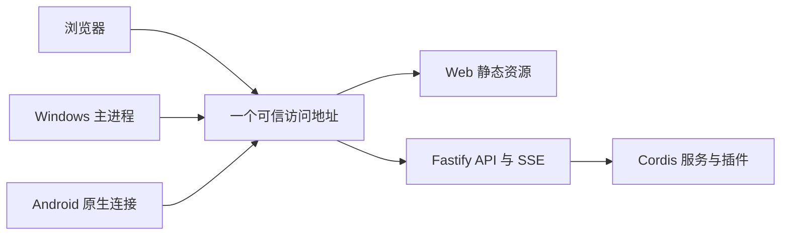

# Recorder PC 与远程服务器接入提案

状态：部署建议，未配置服务、网络、证书、代理或外部平台。更新日期：2026 年 10 月 25 日；本页网络技术资料核对日期：2026 年 10 月 24 日。

阅读时机：决定后端监听范围、Web 发布、LAN/外网接入、反向代理或地址切换时。业务协议见 [统一 API](../interfaces/unified-api.md)，身份机制见 [认证和多设备](../security/identity-device-access.md)。当前已确认先个人使用、以后保留增加账号的空间；PC 是否需要从外网访问仍待明确，本提案保留相应选项。

## 1. 同一后端，按需要改变接入范围

| 部署场景 | 推荐入口 | 优点 | 代价或限制 |
| --- | --- | --- | --- |
| 仅 PC 本机 | 回环监听；本地 Web 与 API 同源，Electron 连接同一 API | 不依赖互联网，部署步骤少 | 手机不能访问手机自己的 localhost 来连接 PC |
| 同局域网访问 PC | 显式开启指定 LAN 入口，提供受客户端信任的 HTTPS | 手机访问 PC 资料库，业务代码无需改变 | 需处理地址、防火墙、证书信任及 PC 休眠 |
| 在外访问个人 PC | 优先评估私有 VPN／组网，再连接同一 API | 适合少量个人设备，可减少公网入口维护 | 所用设备需接入私网；PC 关机、休眠或断网仍不可达 |
| 公网访问 PC | HTTPS 代理配合可用入站网络，或经验证的隧道 | 浏览器和客户端可从外网访问 | NAT、域名、证书、转发路径及视频传输限制需处理 |
| 远程服务器 | HTTPS 单一入口，反向代理到私有监听的 Fastify | 不依赖家中 PC 持续运行，便于所有端使用固定地址 | 需承担服务器运行、更新、备份与网络维护 |

默认建议从回环监听开始，开放 LAN 或远程入口时显式配置范围；不要因为出现 Android 客户端就直接监听所有网卡并假定已经完成接入设计。云服务器也可以只通过私网访问，不要求自动公开到互联网。

这些场景共用同一业务 API 与认证。网络层决定能否连接，应用层决定连接后能做什么；加入 VPN 不自动获得 Recorder 账号权限。

## 2. Web 与后端分离，不要求部署在不同来源

推荐一个入口同时提供 Web 静态资源和 /api 路径：构建与源码仍分别位于 web 和 backend，线上由反向代理或后端静态资源适配组合。同源让 Cookie、文件访问、CSRF 与 SSE 的行为更可控。

Electron 和 Android 仍优先加载随应用分发的 UI；它们连接远程 API，不是把任意远程网页赋予本机桥接能力。后端插件可提供 UI 贡献描述或受控资源，不能因此跳过客户端包与能力兼容检查。

若以后确需单独 Web 域名，再设计明确的来源白名单和认证方式。开发期 Vite 代理可用于保持请求路径一致，但开发服务器不作为正式发布服务。当前没有生成任何代理配置。

## 3. 本机与局域网的具体边界

纯本机可评估只对回环地址开放 HTTP 的专用模式，仍保留登录、请求授权、Host/Origin 检查与 CSRF 防护。仅本机模式与 HTTPS 模式的 Cookie 配置分开；不能无条件要求 HTTP 下 Secure Cookie 生效，也不能把该例外复制到局域网。HTTP 模式不使用要求 Secure 的 __Host- Cookie 名称；localhost 与 IP 的实际浏览器行为需验证。

Cookie 不以端口作为隔离边界。同机不同服务应使用明确的 Cookie 名称与来源策略，避免把换一个端口视为完整隔离。本机恶意进程不在“只有 localhost 能访问就安全”的保证范围内，因此不把本机网络地址当作账号身份。[Cookie 规范的安全边界](https://www.rfc-editor.org/rfc/rfc6265.html)

LAN 模式需指定手机可达的 PC 地址、监听接口和防火墙范围。建议使用稳定名称或明确的地址配置；自动发现如后续需要，只提供候选地址，不自动建立信任或发送凭据。

LAN HTTPS 可使用客户端信任的域名证书，或受管理的本地 CA。Caddy 能处理本地 HTTPS，但其本地根证书不会自动被所有手机、浏览器和应用信任；Android 还需核对应用信任配置。不能通过关闭证书校验来省去这一步。[Caddy HTTPS 与信任说明](https://caddyserver.com/docs/automatic-https)

同机 Electron 的快捷唤起不等待网络请求；本地后端不可用时明确显示状态。桌面安装包是否携带后端、由谁启动及保持运行仍未确定；打开一个 Electron 窗口不应隐含成为其他设备的服务存活条件。

## 4. PC 外网访问的候选方向

| 方向 | 适合什么情况 | 推荐理由与取舍 |
| --- | --- | --- |
| 私有 VPN／组网，例如 Tailscale 一类方案 | 主要是自己的 PC、手机和其他已登记设备 | 可提供稳定私网连接与设备管理；需要安装/配置客户端及相应账号或控制服务 |
| 域名 + HTTPS 反向代理 | 有可达入站网络，希望直接用浏览器访问 | 入口直观；家庭网络能否入站、地址变化及端口转发需要另行确认 |
| 反向隧道 | 家庭网络无法直接入站 | 可提供另一条接入路径；需评估供应方、访问策略、带宽、文件大小和长连接支持 |
| 改由远程服务器承载主要后端 | 希望家中 PC 关闭后仍能访问完整资料 | 降低对家中设备在线的依赖，但增加服务器维护；不自动与 PC 后端同步 |

个人多设备场景下，若需要外网访问 PC，当前优先研究私有组网；具体产品未选择。Tailscale 官方提供多设备加入、稳定地址和命名能力，这里只把它作为可核验的候选例子，不安装或创建账号。[Tailscale 官方接入说明](https://tailscale.com/docs/how-to/quickstart)

PC 关机后，VPN、代理或隧道都不能让其 Recorder 服务继续处理请求。Android 按已确认需求保留待提交内容，已有系统登记提醒仍按设备条件触发；这些不等于可离线访问完整业务库。

## 5. 远程服务器的推荐形态

推荐 **单一 HTTPS 地址 → 反向代理 → 私有网络或回环监听的 Fastify**，数据库与资料库继续在后端所在设备。个人规模先保持一个业务后端实例，不因多客户端就引入集群或多份 SQLite 写入节点。

Caddy 可作为优先候选，理由是有自动证书申请与续期能力；已有 Nginx 等运维体系也可沿用。代理不是当前已选依赖，证书自动化仍依赖域名、验证路径及服务器条件。[Caddy 自动 HTTPS](https://caddyserver.com/docs/automatic-https)

代理需正确转发 /api、上传、下载和 SSE，配套合适的请求大小、超时与流式输出设置；不能让普通页面缓存或缓冲配置吞掉实时事件。Fastify 的内部端口不同时作为绕过代理的公网入口。

只信任明确的代理地址或经过验证的代理链，不普遍相信客户端传来的 X-Forwarded-*。服务生成授权或回调地址时使用已配置并验证的外部来源，不能由任意 Host 头决定。这样也能让 HTTPS 后面的 Cookie、登录限流和客户端地址判断保持正确。[Fastify trustProxy](https://fastify.dev/docs/latest/Reference/Server/#trustproxy)

后端可作为独立服务随系统启动，但 Windows/Linux 服务配置与打包方式留到实现阶段。备份至少考虑数据库、附件、实例标识和必要配置；身份材料恢复、旧会话是否保留需要单独约定，不能把备份公开当作静态文件目录。

备份已选统一恢复集合 + 后台复制及 restic，采用本地独立副本与加密异地副本，日常只接受很短的快照窗口；先读 [备份主线](../../current/storage/backup-baseline.md)，具体流程见 [备份恢复提案](../storage/backup-recovery.md)。PC 的休眠与外接盘、服务器的持久卷与目标权限分别验证；调度由后端承担，不依赖桌面窗口保持打开，[restic 集成](../storage/restic-integration.md)、版本及目标仍待细化。

## 6. 多地址、多实例与迁移

同一个后端可能有本机、LAN、VPN 和域名等多个地址。实例标识用于识别同一数据来源，但地址之间的信任和账号授权不能只凭这个标识推导；证书校验、用户确认及凭据目标绑定仍需保留。

Web Cookie 按其域名、路径和安全属性等规则发送，换一个域名可能需要重新登录；端口并不提供 Cookie 隔离。原生端也不能把旧地址的凭据无条件发往新地址或跨主机重定向；增加地址应先确认归属和可信连接。使用稳定入口可减少地址切换成本。

PC 与云服务器各起一份后端时，它们是两个独立实例。迁移需显式搬运并核验数据库、附件和身份配置，处理实例身份与会话；不能把客户端改 URL 就视作数据已迁移。当前不设计两端自动同步或无缝故障切换。

正式搬迁应停止旧主库写入并取得最终恢复点，按 [恢复与切换流程](../storage/backup-recovery.md) 在新位置验证后再开放服务；旧快照之后的写入不会因为修改地址自动补齐。

## 7. 待定事项与验证

待明确：PC 是否需要外网访问、主要部署位置、稳定地址与域名、私网或公网入口、代理选择、证书信任方案，以及后端随系统/桌面应用启动的方式。选型建议不代表本轮已启用任何端口或网络服务。

实现阶段验证本机 Web 与 Electron、LAN Android、远程 HTTPS、代理下 Cookie/CSRF、Bearer 会话、SSE 重连、大文件传输、错误证书拒绝和后端断连恢复。身份与 API 的测试入口见对应提案；本轮未执行运行测试。

返回 [设计索引](../README.md) 或 [文档总导航](../../README.md)。
