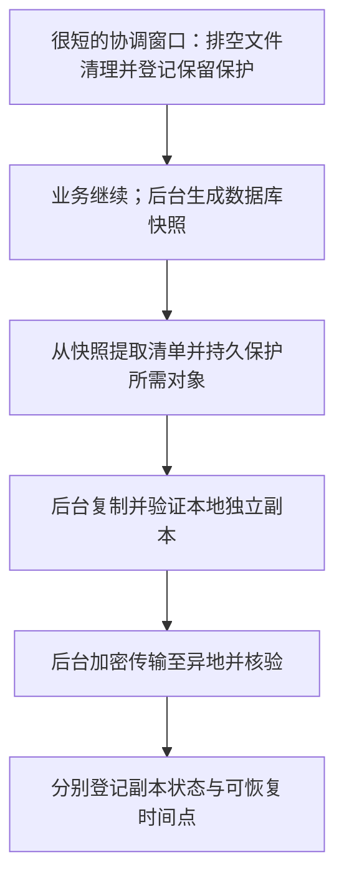

# Recorder 备份与恢复方案提案

状态：统一恢复集合 + 后台复制、备份体验、副本方向及 restic 已确认；本篇细化日常备份协议，具体版本、清单格式、周期和恢复契约仍为建议。更新日期：2026 年 10 月 27 日；官方资料核对日期：2026 年 10 月 25 日。B002-T02 已验证隔离样本的本地数据库恢复点，见 [当前主线](../../current/storage/backup-baseline.md)；未安装 restic、建立日常备份或执行隔离恢复。

阅读时机：设计日常备份、升级前恢复点、附件保留、插件恢复、PC/服务器搬迁或灾难恢复时。先读 [已确认备份主线](../../current/storage/backup-baseline.md)、[数据访问主线](../../current/storage/data-access-baseline.md)；工具适配读 [restic 集成](restic-integration.md)，文件提交见 [存储生命周期](storage-lifecycle.md)，升级见 [迁移机制](plugin-migrations.md)，网络入口见 [部署接入](../operations/deployment-access.md)。

## 1. 已确认主线与细化前提

- 已选 Recorder 统一命名空间账本 + 受控 SQL 执行适配，插件卸载默认保留数据。
- 结构升级允许暂停业务写入，优先完整性与可靠恢复；**日常备份尽量保持可用，只接受很短的快照窗口**，不能把两个场景混为全程维护停写。
- 备份副本方向为 **本地独立副本 + 加密异地副本**；具体磁盘、NAS、存储服务、费用、周期、保留期限和密钥方案未选。

已确认由后端统一组织恢复集合并后台复制：**数据库一致快照 + 该快照引用的托管对象 + 插件与迁移材料 + 必要配置和受保护恢复材料**。本地与异地保存同一逻辑恢复点的内容，分别显示完成状态。以下建议给集合设置版本、清单和逻辑备份 ID，具体格式仍待细化。后端资料库仍是集中存储，不把备份变成第二个同步业务后端。

本提案以当前推荐的核心与插件同库、原始附件由公共文件服务管理为前提。若以后允许独立插件数据库或任意私有目录，必须重新定义一致性协议，不能自动宣称整库快照覆盖它们。

## 2. 一次完整备份包含什么

| 内容 | 推荐处理 | 原因与限制 |
| --- | --- | --- |
| SQLite 数据库 | 整库一致快照，含核心表、所有插件表、账号、记录关系、作业、幂等状态、命名空间目录与迁移账本 | 不按“当前启用插件”筛选，保留停用及卸载插件的数据；回收站也在其中 |
| 托管原始附件 | 按快照清单保存字节、对象标识、大小与摘要 | 包括回收站、插件专属引用和其他仍需保留的对象；多个引用可共用一份物理对象 |
| 插件及迁移材料 | 保存插件 ID/版本/状态、schema revision、迁移摘要、清单、必要 SQL/回填材料；不可再下载的私有插件需保存可信发布包 | 有表不代表还能够解释数据；保存代码不代表恢复时自动执行 |
| 必要配置 | 与快照匹配的业务配置及部署配置说明 | 数据目录、域名、代理、外部服务凭据须在目标机重新核对，不能照搬 PC 绝对路径 |
| 秘密与恢复材料 | 恢复所需的数据解密材料受保护备份；账号和会话视为敏感内容 | 仓库解密口令/恢复密钥须另有离机保管途径，不能仅放在它自己加密的备份内 |
| 外部关联文件 | 默认保存引用和“未包含原字节”的清单 | 引用不等于文件副本；可另设复制外部原件选项，但必须处理文件变化、权限和一致性，不默认扩大读取范围 |
| 上传暂存、客户端未提交输入 | 已提交后端资料必须覆盖；未完成上传默认不承诺可恢复原进度，明确列出排除项 | Android 尚未提交的资料不在后端，后端备份不能覆盖它；恢复后清理/重置失效上传会话需专门规则 |
| 可重建缓存/索引 | 可标记排除或恢复后重建 | 用户编辑过的转写、摘要等属于正式资料，不能当缓存省略；同库物理快照也不为减小体积随意删表 |

插件私有文件优先进入公共对象与引用目录，卸载后仍可枚举。对尚未声明的私有数据不能报告“完整覆盖”；需要补充持久清单或阻止完整备份认证，而不是仅调用在线插件的导出钩子。保留表名、账本与数据不意味着未知业务字段可被核心任意编辑。

建议清单包含备份格式版本、备份 ID、源实例/恢复代次、快照起止时间、数据库摘要、插件版本集合、迁移账本摘要、对象列表及大小/摘要、配置与必要恢复材料说明、排除项和验证结果。部署版本与最低读取要求需记录；不将口令明文写入清单。

## 3. 数据库快照方式

| 方式 | 优点 | 限制与判断 |
| --- | --- | --- |
| SQLite Backup API，经 better-sqlite3 的 backup 能力适配 | 生成一致数据库副本，可分步完成，适合后台作业 | 只处理数据库；并发修改会影响推进和重启行为，需与附件保留协作；优先验证 |
| VACUUM INTO | 输出紧凑的数据库副本 | CPU/耗时和目标文件要求不同；中断产物不可当完成备份，不作为日常默认路径 |
| 全部连接干净关闭后的离线复制 | 易理解，适合经安排的维护或搬迁 | 服务不可用时间包含复制，不符合日常备份优先目标 |
| VSS/卷或虚机快照 | 可辅助环境级恢复 | 多卷、应用提交、插件和外部资料是否一致取决于具体方案；未验证前不能替代 Recorder 的恢复集合 |

SQLite Backup API 提供一致数据库副本；better-sqlite3 官方说明 backup 为异步任务，同连接修改会反映到备份，其他连接修改可能使备份重新开始。因此备份内容不能无条件解释为“点击按钮那一瞬间”的状态，应记录快照生成区间，从完成的副本读取清单，不用任务开始时扫描的文件列表冒充对应版本。[SQLite Backup API](https://www.sqlite.org/backup.html)、[better-sqlite3 backup](https://github.com/WiseLibs/better-sqlite3/blob/master/docs/api.md#backupdestination-options---promise)

VACUUM INTO 是另一种一致快照方式，但不改变跨文件一致性的责任。[SQLite VACUUM INTO](https://www.sqlite.org/lang_vacuum.html#vacuum_with_an_into_clause)

WAL 模式下，已提交内容可能仍在 WAL 中。不能一边运行服务一边仅复制主数据库，也不能把不同时刻复制的主文件与 WAL 拼起来；优先使用快照接口得到独立产物，不附带来源库的任意旧 WAL。恢复到新目录也不混入目标原有的 WAL/SHM。[SQLite WAL 持久状态](https://www.sqlite.org/wal.html#the_wal_file)

## 4. 很短的协调窗口，后台完成大部分工作

推荐采用以下流程，实际暂停预算、超时和 I/O 限速待实测确定；不承诺固定秒数。

1. **预检与协调。** 检查空间、目标权限、密钥可用性和上次未完成任务。备份、恢复、升级与插件数据清除共用协调机制；备份开始时只短暂阻止必要的新提交和物理清理，排空冲突的在途动作，持久登记备份保护状态。无法在窗口预算内完成就延期或失败，不静默扩大停写时间。
2. **固定结构与配置。** 暂缓迁移、插件安装/卸载、HMR、破坏性清理及影响恢复的配置/密钥变更，封存或持续保护匹配的配置与插件材料，不能只记录版本号却让相应文件随后被覆盖。普通记录新增、修改和逻辑删除恢复可用；上述管理变更可延后到快照和清单固定之后，不要求整个异地上传期间禁止升级。
3. **后台生成数据库快照。** 文件回收保持暂停，覆盖快照过程中新增或被移除引用的对象，而不是只保护最初扫描到的对象。使用所选驱动的备份能力，成功关闭并保护快照产物后再读取它；持续写入导致过久或重启时可取消重试，不能自动退回长时间停写。
4. **从完成的快照确定范围。** 枚举所有必要对象和保留插件引用，验证没有遗漏。先把逐对象的备份保留关系持久登记，再解除全局清理暂停；这一步必须与文件回收串行协调，不能留出“已恢复清理但还没登记保护”的空档。完成固定后可释放结构/配置变更限制。
5. **后台复制到本地独立目标。** 复制快照、对象、清单和恢复材料，校验后封存同一备份 ID。复制期间业务继续；源对象在独立副本可靠完成前仍受保护。暂存在工作盘上的导出目录只是中间产物，不能算已获得独立副本。
6. **后台加密异地传输。** 从已封存的恢复集合上传或复制到异地仓库，保留本地集合的上传使用权，失败按原备份 ID 重试；不用稍后的数据库快照混配较早的附件集合。本地副本未就绪而异地已就绪也要分别报告，不能用一个成功状态掩盖另一侧缺失。
7. **完成和释放。** 每个目标分别确认覆盖清单、持久提交及验证等级，再登记其可恢复点。源对象保留可在完整独立副本得到可靠承接后释放；异地尚未完成时，本地承接集合不能被保留策略清除。崩溃重启先对账再回收，不仅凭任务超时自动解除保护。

这个流程依赖两项存储约束，均须实现验证：**正式对象不原地修改**，替换文件生成新对象并在事务中切换引用；**正式记录引用的对象已完成持久发布**。文件摘要或名称不是不可变性的自动保证，软链接/硬链接也不是独立故障副本。数据库逻辑删除可以继续，但被备份保护的旧对象须延后物理删除。

备份保留关系独立于当前业务引用存活，不能随记录或插件数据的级联删除一起消失；对象及其定位信息在保留释放前必须仍可读取。多个任务引用同一对象时分别登记，完成一个任务不释放其他任务所需内容。

数据库副本可能包含备份任务自身、旧上传或运行中的作业记录。恢复时要把这些运行状态与实际目标重新核对，不把快照中的“进行中”状态当作仍有进程执行，也不因此永久锁住文件回收。

如果现有文件服务不满足上述约束，不能宣称在线备份正确；应先补足协议或报告限制。日常备份不默认降级为全程停写。升级前可使用已经允许的维护窗口生成最后恢复点，两种工作流共享清单与校验，但不共享全部可用性假设。

## 5. 本地与异地副本如何组织

推荐每个备份 ID 都表示逻辑完整的恢复集合；物理存储可去重或增量传输，但恢复不要求用户手工排列多个 SQL 差量文件。数据库先采用完整一致快照；附件按不可变对象复用，避免每次重新传输全部音视频。去重比例和空间节省取决于实际数据，不预先承诺。

| 场景 | 本地独立副本 | 加密异地副本 | 部署重点 |
| --- | --- | --- | --- |
| PC 后端 | 独立物理盘、可移动硬盘或经验证的 NAS 目标 | 与 PC 不同故障位置的远端仓库 | PC 睡眠、关机、磁盘拔出会中断任务；启动后对账并补跑，不能把计划时间当完成时间 |
| 远程服务器后端 | 独立备份卷/磁盘或本地存储服务，明确共享哪些硬件与账号风险 | 不同主机/区域或其他独立存储，按需求评估账号隔离 | 数据目录应持久化，副本不只放在应用临时目录；异地目标与生产目录分别授权 |

服务器中的另一个文件夹、同盘分区或同宿主机副本不足以覆盖整机丢失；单独卷的独立程度需按实际基础设施确认。用户选择的本地与异地两类副本仍保留，目标未确定前不把任意两条路径当成达标。NAS 可以作为备份目标，不因此把运行中的 SQLite 改放在网络共享目录。[SQLite WAL 跨机器限制](https://www.sqlite.org/wal.html)

备份由后端服务执行和调度，不依赖 Electron 窗口持续打开；具体系统服务/调度工具未选，也没有在本轮创建定时任务。客户端只负责启动、查看进度、下载获授权导出及发起恢复流程。远程备份包包含全部资料与身份信息，属于实例级管理权限，不放进 Web 静态目录或普通附件下载入口。

PC 与服务器搬迁使用同一格式，但必须重新配置目标路径、访问地址、证书和插件运行依赖。插件的原生二进制可能需要目标平台对应构建，不能把 Windows 的整个运行目录当作 Linux 可执行环境。完成搬迁前停止旧主库写入并取得最终恢复点，之后确保只有一个正式后端；普通在线旧备份不能提供搬迁时的零数据遗漏保证。

## 6. 备份工具与职责分工

| 方向 | 优点 | 成本与推荐 |
| --- | --- | --- |
| Recorder 生成封存集合，适配成熟备份工具保存多个版本 | 一致性由业务层保证，传输、加密、去重与仓库管理复用已有能力 | 需固定工具版本、适配退出状态与恢复；当前优先方向 |
| Recorder 自行管理完整归档与多目标复制 | 格式和交互容易直接控制，单次手工导出直观 | 大视频重复复制成本高，还需维护加密、重试、保留和检验；适合补充导出，不优先自研通用增量备份引擎 |
| 仅使用云盘同步/卷快照 | 配置可能简单，可补充环境恢复 | 未必知道数据库、附件和插件依赖关系，删除还可能传播；不能作为本提案唯一的一致性机制 |

**备份工具已选 restic，具体版本尚未锁定，没有安装。** 保留、多目标复制与 Cordis 插件/进程管理统一在 [restic 集成](restic-integration.md) 维护，选择理由见 [历史比较](../../history/research/backup-tool-comparison.md)。工具消费固定的恢复集合，Recorder 负责清单与恢复前后处理，不把资料库一致性委托给普通文件扫描。

工具扫描活跃数据目录不自动获得应用一致性，只向适配层提供已固定的快照及受保护对象。适配必须解析失败/部分成功：例如 restic 的退出码 3 表示部分源文件未读到，即使产生 snapshot 也不能标为完整备份。[restic 备份结果](https://restic.readthedocs.io/en/stable/040_backup.html#exit-status-codes)

异地副本要求离开后端前完成加密，并保护清单等元数据；TLS 只处理传输通道，不代替存储加密。已选 restic 管理的本地和异地仓库均加密，具体凭据保存和恢复方式仍待设计；运行资料和暂存目录不因此自动加密。口令与恢复材料应可在原电脑完全损坏时取回；依赖原机系统密钥保护的凭据，不能被当作已经可跨机恢复。丢失所有解密材料会导致无法恢复，需通过离机恢复演练验证。[restic 密钥与仓库访问](https://restic.readthedocs.io/en/stable/030_preparing_a_new_repo.html)

加密不防删除。备份目标使用独立权限；若后续需要不可变保留/只追加存储，再核对目标与工具兼容性，不能把它当作当前默认已配置功能。副本保留期限与删除权限独立于业务回收站规则。

## 7. 备份有效性、频率与保留

建议状态至少区分：生成中、清单完整且本地已封存、异地待上传/失败/已提交，以及最近一次检查和试恢复结果。只有目标中清单所需内容齐全、已持久提交并通过规定校验，才标为该目标的完整副本；“上传完成”“校验通过”“实际试恢复成功”分别表达，不用一个绿色标记替代所有证据。

生成时核对数据库完整性、外键、命名空间/账本、附件存在与摘要、配置和插件材料。SQLite 的 integrity_check 不检查外键，必须另用 foreign_key_check，并补充业务引用断言。[SQLite 检查边界](https://www.sqlite.org/pragma.html#pragma_integrity_check)

对远端定期做数据读取检查，并从备份恢复至隔离目录进行业务抽查。只检查仓库索引不等于读过所有字节；restic 默认 check 与读取数据检查也有区别，后者的时间和流量成本需纳入周期。[restic 仓库检查](https://restic.readthedocs.io/en/stable/045_working_with_repos.html#checking-integrity-and-consistency)

频率以两项尚未明确的目标决定：最多能接受丢失最近多久的数据（恢复点目标），以及希望多久恢复可用（恢复时间目标）。每日、每数小时、手动导出和升级前备份可分别配置，但本轮不默认选定数字。界面显示最近完整快照的时间区间和异地滞后，不能用今天的上传完成时间掩盖几天前的资料状态。

建议分层保留近期与长期恢复点，升级前恢复点另行保护；具体份数和天数待资料量明确后选择。新备份失败不触发删除最后可用副本；正被恢复、校验或等待异地复制的集合不能回收。仓库去重对象的回收交给其引用管理，不让应用按单个文件年龄删掉共享块。以 restic 为例，删除快照和回收未引用数据是不同步骤。[restic 保留与回收](https://restic.readthedocs.io/en/stable/060_forget.html)

插件卸载、记录清空不自动从既有备份抹除资料。恢复旧时间点可能重新出现当时存在、后来删除的数据；清空当前资料库与备份保留必须在界面上说明，不能承诺立即擦除所有历史副本。

## 8. 恢复流程与边界

**优先设计整库恢复，单记录/单插件导入另议。** 业务表、核心记录、标签和附件存在交叉引用，不能直接将旧插件表覆盖进当前库。需要找回单项时，可先在隔离环境读取旧集合，再由正常业务导入协议处理 ID、归属、重复与引用。

1. **选择与预览。** 展示目标备份、源实例、数据时间区间、插件版本、排除项和将被替换的资料范围。整库恢复属于显式管理动作，优先保留当前现场；新建空目标不必伪造旧现场备份。
2. **隔离读取。** 将完整集合恢复到新的受限目录，验证清单和解密材料。只读取声明信息，不因为备份含插件代码就自动执行；验证压缩路径、链接与文件范围，避免越出恢复目录。
3. **匹配程序和插件。** 用能理解该账本及 schema 的版本验证。必要升级在工作副本上经统一迁移协调执行，保留原备份不变。缺失插件时保留其表和对象；是否仅启用核心可读能力取决于兼容验证，不能静默丢表。
4. **验证可恢复性。** 检查数据库、外键、所有必要附件、迁移历史与关键记录。派生索引可重建；缺少原始附件不能以生成空文件替代。外部引用标记未包含/需重定位，不能把“可恢复引用”写成“原件已恢复”。
5. **受控切换。** 停止目标业务与作业、关闭连接，核对没有另一实例写入后切换数据目录。Windows 文件占用和跨卷操作需分别验证；不覆盖打开的 SQLite，不混用旧 WAL，不在原目录边解压边上线。
6. **身份和设备对账。** 推荐正式恢复时使旧会话失效，使用受控恢复凭据重建访问；账号口令及授权也可能回到旧状态，需明确处理，具体登录体验待定。生成新的恢复代次，客户端刷新事件游标、缓存、上传会话和提醒计划，而不是仅凭原 instanceId 继续旧状态。
7. **分阶段恢复运行。** 先验证只读与必要写入，再放行后台作业。恢复后重新计算未来提醒，不盲目重放旧任务；外部已发生的动作不能被数据库恢复撤销。验证通过后登记恢复记录，再按保留策略处理旧现场。

正式接替、测试恢复与复制成新实例需要区别：正式接替保证旧主库停止；试恢复默认不发送通知、不执行 AI/外部动作、不公开服务；独立新实例应有独立身份与客户端绑定。不能让两个同身份副本同时接受写入。

恢复至较早时间点会丢失该点之后的后端提交及幂等记录；Android 可能仍认为某些内容已提交，不能假定手机持有完整历史副本。待提交队列保留原归属，经过重新认证和代次检查再提交，避免无条件重试重建已删除内容。离线手机已有提醒无法立即撤回，重新连通后需取消/重登记；不能承诺整个恢复过程无重复提醒或完全无数据损失。

灾难恢复入口不能依赖损坏数据库先成功启动所有业务插件。建议提供后端最小维护入口/恢复命令，复用同一清单与验证服务，不新造插件加载体系；具体入口与授权方式尚未选定。

## 9. 故障处置和验证计划

| 情况 | 推荐处理 |
| --- | --- |
| 磁盘满、外接盘拔出、对象缺失 | 本次不标完整，保留上个可用副本和明确错误；不自动删除用户资料腾空间 |
| 后端崩溃或 PC 睡眠中断 | 重启对账备份 ID、保护关系和目标提交状态；重试或显式放弃后再释放保护 |
| 本地成功、异地失败 | 显示异地滞后，保留可重试来源，不虚报两份都完成 |
| 迁移、卸载、清除与备份冲突 | 按协调规则串行或延期，不能在扫描中混合不同 schema/配置 |
| 目标生成部分快照 | 仍标不完整；明确缺少哪些内容，不能作为正常整库恢复候选 |
| 恢复后插件或原生模块不兼容 | 保持维护/受限读取，修复兼容性，不以删表绕过 |

实现验证应覆盖：备份中新增/替换/删除附件、回收站及卸载插件引用、不断写入导致快照重试、保护登记前后崩溃、双任务竞争、复制与上传中断、损坏对象、丢失密钥、独立机器完整恢复、Windows/服务器搬迁、恢复后的会话与 Android 队列/提醒对账。仅比较摘要不能代替实际恢复演练。

待定：格式与清单、不可变对象协议、保护关系实现、快照窗口预算、restic 版本及集成、目标和容量、频率/保留、密钥保存与恢复凭据、授权 UI、恢复代次协议和恢复耗时目标。当前仅完成官方资料研究及文档，不声称已验证一致性、性能或跨平台恢复。

返回 [设计索引](../README.md) 或 [文档总导航](../../README.md)。
