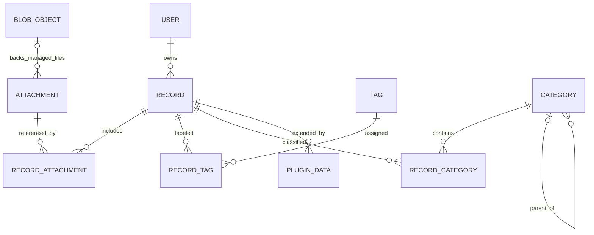

# Recorder 数据模型细化设计

当前附件实施以 [B005 任务卡](../../work/b005-managed-attachments/README.md) 为准：本批托管附件不跨记录共享，单独删除经明确确认后永久清理；正文可为空用于文件记录。下文共享引用、去重及完整生命周期机制仍是后续提案，不作为本批全部前置。

状态：模型主线已确认，具体实体拆分、字段和约束仍为建议；尚未创建数据库。更新与资料核对日期：2026 年 10 月 24 日。确认范围见 [数据模型主线](../../current/storage/data-model-baseline.md)。

阅读时机：设计记录、附件、标签分类、查询和数据归属时。先读 [当前需求](../../current/product/requirements.md) 与 [API 和认证主线](../../current/architecture/api-auth-baseline.md)；落盘和删除见 [存储生命周期](storage-lifecycle.md)，插件数据见 [插件扩展](../plugins/data-extension.md)。以下名称均为候选逻辑实体，不是已实现的表或接口。

## 1. 已确认需求与结构方向

已确认：后端集中存储，SQLite + better-sqlite3；文件默认托管，也保留外部关联；先个人使用，预留账号；每条记录可有多个标签、同时放入多个分层分类；删除先进入回收站，清空时确认彻底删除。

已确认采用 **统一记录基础 + 独立附件 + 标签分类关联 + 插件业务表**。下面的候选字段、附件物理分层和 JSON 用法仍需细化。

| 结构方向 | 优点 | 局限与判断 |
| --- | --- | --- |
| 所有业务字段不断加入记录大表 | 初期查询直观 | 日程、开销、订阅互不相关的字段越来越多，插件变更牵动核心；不推荐 |
| 每条记录只有一个任意 JSON 或通用属性表 | 易容纳未知字段 | 关联、约束、统计和迁移变复杂；不作为全部业务的模型 |
| 核心关系表 + 插件关系表 + 少量有版本的 JSON | 共享组织能力，业务字段可独立演进 | 结构主线已选；JSON 用法及具体迁移契约仍为建议 |

例如“项目 A 会议”保存为一条记录，关联纪要、录音和视频；它可同时属于“工作／项目 A”和“会议”，并带“待整理”等标签。待办插件可以关联会议记录或产生新的待办记录，具体交互后续设计。

## 2. 概念关系

图只展示主要关联；标签、分类、附件及用户业务插件数据同样有账号归属。外部关联附件没有托管文件对象。分类单父节点的树形结构是推荐实现，多分类归属已确认；不由此确认分类节点本身可以有多个父节点。

## 3. 记录基础

| 候选信息 | 作用与约束 |
| --- | --- |
| id、owner_id | 稳定身份与所属用户；ID 不使用文件路径、标题或分类名；具体生成格式待定 |
| title | 可选标题，快速收集不强制填写；展示时可由正文片段或文件名提供候选 |
| body、body_format | 可选正文和明确格式；建议先允许普通文本/Markdown，富文本协议另议 |
| created_at、updated_at | 后端创建与修改时刻；客户端声称的采集时刻单独保存，不覆盖服务端时间 |
| version | 并发修改版本；与插件 schema 版本、程序版本分开 |
| deleted_at | 回收站状态；不复用待办完成、订阅到期等业务状态 |
| source 信息 | 采集方式、原始来源及必要的设备标识；不保存认证令牌或无边界的原始请求 |

纯文件记录可以没有正文；文本记录可以没有附件；一条记录可以同时包含多种内容。不把“文字／视频／日程”设计成彼此排斥、由核心不断扩充的唯一业务类型。

先保留简单正文格式，暂不建设通用块编辑器或完整修订历史。正文与记录元信息是否拆表按查询和内容规模决定；列表只取摘要，不每次读取完整正文。音视频、扫描件的识别文本属于可追溯的派生结果，不能覆盖原始内容。

建议初期用记录级版本覆盖正文、附件关联、标签分类和纳入该记录的插件业务修改，条件写入成功后统一增加版本。跨记录或大型插件实体可另有版本，但必须声明冲突边界。普通时间戳不足以替代版本判断。

## 4. 附件与实际文件分开

| 候选实体 | 保存什么 | 为什么分开 |
| --- | --- | --- |
| attachment | 用户可理解的文件身份、原始名称、媒体类型、归属、托管/外部模式 | 文件名和展示信息不决定磁盘路径 |
| blob_object | 托管字节的内部标识、存储键、大小、摘要及状态 | 便于完整性检查、迁移和后续去重；大文件保存在资料库 |
| record_attachment | 记录与附件关联、用途、排序和该处说明 | 同一个附件可以被不同记录引用，移除一处不影响其他记录 |
| external_reference | 后端可访问的位置和失效状态，具体字段待定 | 清楚表达“仅关联”，不冒充已复制保存 |

建议附件复用先限定同一用户。内容摘要用于校验和候选去重，不是访问凭证；初期可以不做物理去重，分层并不要求现在实现去重系统。不因摘要一致就给另一个账号访问权限。

托管对象建议写入后不可原地修改；替换文件产生新对象并通过有版本的关联更新生效。是否保留旧版本另定。外部引用可能被用户从原位置修改、移动或删除，不能提供与托管对象同等的不可变保证。

客户端传来的 Windows 路径或 Android content URI 不能直接作为远程后端路径使用。仅关联后端可访问位置的权限、路径边界和重定位规则须单独定义；删除引用默认不删除原文件。

## 5. 标签和分层分类

本节分类查询/删除约定已按 2026 年 10 月 28 日用户确认更新；实现进度以当前模型主线与 B004 为准。

用户已选 **多个标签 + 多个分类归属 + 分类可以分层**。推荐区分用途：标签表达“这是什么/处于什么状态”，分类表达用户整理资料的层级位置。

- tags 与 record_tags：每用户独立标签，记录与标签多对多；关系去重，名称规范化与重名规则待定。
- categories 与 record_categories：分类建议采用 id + parent_id 的树；记录可同时关联树中多个节点，无需复制记录或附件。
- 分类移动检查同一用户、禁止自指和环；分类更名或移动不改附件磁盘位置。
- 当前确认：查看分类默认包含全部后代，按记录 ID 去重，分页和 total 同样去重；具体实施见 [B004 任务卡](../../work/b004-record-categories/README.md)。
- 当前确认：从分类移除记录只解除归属；明确确认后可删除所选整棵分类树及其关联，所有正常/回收站记录、标签和树外分类关系保留。恢复记录不重建已删除分类。全局标签删除不属于当前批次。
- 暂未分类可由“没有分类关联”查询表达；以后动态筛选视图可独立扩展，无需制造重复记录。

建议分类不承担账号权限边界，当前没有多用户共享目录需求。名称规范化应兼顾中文、大小写和空白，具体规则通过样例确定，不提前固化为简单英文小写。

## 6. 数据归属与约束

后端从认证上下文确定 owner_id。记录、标签分类、附件和插件业务引用必须属于当前用户；查询、下载、搜索、回收站、导出与幂等结果均保持同一边界。

数据库可用带 owner_id 的组合唯一键与外键约束同账号关联，服务层继续检查操作权限；不能只给关联表多加一个 owner_id 就认为引用已经安全。SQLite 连接需显式启用并核对外键约束，服务端所有相关连接保持一致。[SQLite 外键](https://www.sqlite.org/foreignkeys.html)

推荐对核心结构评估 STRICT 表，配合 NOT NULL、CHECK、UNIQUE 和索引；STRICT 限定存储类型，不代替业务校验。其可用类型不直接包含 JSON、日期或布尔专用类型，须选择明确的实际编码。[STRICT 表](https://www.sqlite.org/stricttables.html)

标识、时间、金额等格式仍未冻结。公共时间推荐统一 UTC；日程的当地时间、时区和重复规则属于业务数据，不能只存一个 UTC 到期时刻。金额建议由开销插件用有明确币种和精度的整数或十进制编码处理，不用二进制浮点直接承担精确金额统计。

## 7. 查询与待定项

先按实际查询建立 owner、回收站状态、更新时间、标签关联、分类关联的索引；业务插件为自己的到期时间、金额等查询维护索引。多对多筛选优先避免重复行及分页失真。全文检索是可重建索引，中文分词与短词匹配见 [存储生命周期](storage-lifecycle.md)。

仍待细化：正文格式、附件复用交互、文件规模、记录修订历史、ID/时间编码和完整约束。上述逻辑名称与候选字段不是 SQL DDL；查询已选 Drizzle SQL 风格 API，范围见 [数据访问主线](../../current/storage/data-access-baseline.md)，升级机制见 [迁移提案](plugin-migrations.md)。本轮未创建数据库或执行数据测试。

返回 [设计索引](../README.md) 或 [文档总导航](../../README.md)。
