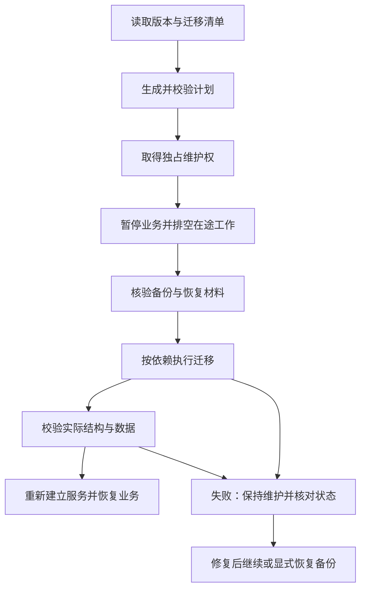

# Recorder 核心与 Cordis 业务插件迁移机制提案

状态：Recorder 统一账本、受控 SQL 与卸载默认保留已确认；初始实现和 B002 子集见下文，其余仍为提案。更新日期：2026 年 10 月 26 日；本页完整方案的 Cordis/Drizzle/SQLite 技术资料核对日期：2026 年 10 月 24 日。

阅读时机：设计核心或插件的数据库升级、迁移账本、兼容检查、失败恢复、卸载和重新安装时。先读 [已确认数据访问主线](../../current/storage/data-access-baseline.md) 与 [数据模型主线](../../current/storage/data-model-baseline.md)。业务表归属见 [插件数据契约](../plugins/data-extension.md)，文件和备份见 [存储生命周期](storage-lifecycle.md)。

## 1. 前提与总体建议

后续实施更新（2026 年 10 月 26 日）：T01 已实现多版本只读计划、版本依赖、摘要/旧账本验证、逐步事务和安全启动，见 [当前业务流程](../../current/development/first-record-flow.md)。用户确认先说明升级、手动确认后执行，并先创建恢复点。[B002 实施契约](../../current/storage/migration-recovery-contract.md) 的独占、恢复点和离线维护/隔离恢复仍待 T02/T03；本页其余完整升级、恢复启用与插件清除仍为提案。

已确认 Drizzle SQL 风格查询 + better-sqlite3，Drizzle Kit 辅助生成迁移，后端以 Recorder 统一命名空间账本 + 受控 SQL 执行适配协调执行；插件卸载默认保留数据。用户可以接受升级期间暂停业务写入并显示维护状态，优先保证数据完整和恢复可靠。日常备份仅接受很短的快照窗口，另见 [备份恢复提案](backup-recovery.md)，不能套用全程停写假设。

本提案以当前推荐的“核心与插件表共用一份 SQLite 数据库”为前提；同库布局仍待最终细化，不据此设计跨数据库原子提交。推荐 **按命名空间记录数据版本、统一生成执行计划、在维护状态串行迁移、验证通过后启用业务；插件代码与持久数据分别管理**。

Drizzle Kit 负责辅助准备 SQL；Recorder 协调依赖、维护状态和保留规则；SQLite/驱动负责实际事务；Cordis 及 Loader 继续负责服务依赖和运行生命周期。此处定义应用协议，不重新实现插件加载框架。

## 2. 版本分别表示什么

| 概念 | 推荐用途 | 不应混同的内容 |
| --- | --- | --- |
| 产品/插件包版本 | 发布代码与依赖范围 | 升级代码不一定要改表 |
| 数据命名空间 | 例如 core、plugin:subscriptions，标识谁拥有数据结构 | 不使用显示名称或 Cordis 单次加载实例 ID |
| schema revision | 每个命名空间自己的顺序版本与迁移链 | 不用整个数据库一个最大时间戳代表所有插件 |
| 服务/API 契约版本 | 约束核心与插件、客户端之间的调用能力 | 表版本不等于公开接口版本 |
| 行内数据格式版本 | JSON 或序列化内容的解释与回填版本 | 改 JSON 格式未必改变 SQL 表 |
| 迁移账本格式版本 | 协调器怎样读取迁移与执行状态 | 由独立的最小启动流程管理，不依赖普通业务插件 |

先建议核心使用一个 core 命名空间，业务插件分别拥有自己的命名空间；是否细分核心子模块留到实际需要。一个插件的多个配置实例、多个用户通常共享同一套物理表，数据行分别带用户或配置实例标识，不能每加载一个 Cordis 实例就再跑一遍建表迁移。

每条迁移建议包含稳定 ID、前置/目标 revision、依赖条件、执行模式、变更对象、内容摘要和验证步骤。ID/顺序只在本命名空间内解释；生成时间可作辅助信息，不决定跨插件的依赖顺序。

已发布迁移内容保持不可变，成功历史的摘要不匹配时停止升级并报告差异，不自动“更新账本以通过检查”。修复通过新迁移或有明确起点的修复包表达；未成功应用的坏迁移也不能直接跳过后执行依赖它的步骤。摘要用于发现漂移，不替代插件包来源信任。

SQLite 的 user_version 是一个供应用使用的整型值，无法独立表达任意多个插件的版本向量；它最多承担已明确的整体格式标识，不能代替命名空间账本。[SQLite user_version](https://www.sqlite.org/pragma.html#pragma_user_version)

## 3. 账本与 Drizzle 的分工

建议把以下信息分开保存，名称只是逻辑示例：

| 信息 | 内容与原则 |
| --- | --- |
| 命名空间目录 | 所有者、保留状态、当前有效 revision、兼容信息、表与附件引用契约；插件移除后仍存在 |
| 成功迁移账本 | 命名空间、数据代次、迁移 ID/顺序、摘要、提交时间及工具版本；成功记录与对应数据库修改同事务提交 |
| 升级运行记录 | 计划 ID/摘要、起点与目标版本、阶段、备份引用、失败位置和尝试记录；不把“开始执行”当成迁移成功 |
| 分阶段检查点 | 仅供声明支持恢复的回填/文件迁移使用；阶段数据和检查点需一致提交 |

命名空间“当前 revision”若作缓存，必须与成功账本一起更新或能够从账本校正。首次建库用最小、受版本控制的 bootstrap 建立账本；读不懂较新账本的旧程序应拒绝写入，而不是尝试重新初始化。

2026 年 10 月 24 日核对的 Drizzle SQLite 源码在指定账本中查询最新 created_at，并用它与迁移时间比较；配置可指定 migrationsTable。其读取器会计算 SQL 摘要，但已核对的执行循环并没有据此逐条核验所有已应用历史。不同插件目录共用同一默认账本，因此可能漏掉后装插件的较早迁移。这是当时主分支源码证据，锁定发行版本后需要重新确认。[SQLite 执行实现](https://github.com/drizzle-team/drizzle-orm/blob/main/drizzle-orm/src/sqlite-core/dialect.ts)、[迁移读取器](https://github.com/drizzle-team/drizzle-orm/blob/main/drizzle-orm/src/migrator.ts)

已选 **Recorder 维护统一的命名空间成功账本，通过受控 SQL 执行适配消费迁移包**。这样可统一成功状态、插件依赖和恢复规则，后装插件不受其他插件时间戳影响；代价是应用需承担账本与适配的实现及测试。此前分别使用 Drizzle 账本的备选不再作为当前并列选项，选择来源见 [历史决定 D029](../../history/decisions/decision-log.md)。

这一方案不自研 schema diff 或通用 SQL 解析器。Kit 继续辅助生成；发布时将固定版本工具的 SQL、必要快照、元数据与摘要封装为可验证迁移包。执行时使用 SQLite/驱动的 SQL 能力或已验证的工具适配，不以分号简单拆脚本；触发器等 SQL 结构会使简单拆分出错。Kit 的内部目录和快照格式也不能当作永久不变的插件协议。[Drizzle 生成与自定义迁移](https://orm.drizzle.team/docs/drizzle-kit-generate)

核心和各插件分别维护生成范围及历史快照，审查 SQL 只改变其拥有的结构；引用核心表不代表插件获得修改核心表的权利。不能用当前已加载插件拼出的 schema 对真实资料库自动 push，否则可能把未加载插件的表误当作需要删除的结构。历史迁移固定当时的数据定义和回填依赖，避免导入最新版业务模型改变旧迁移行为；事务控制语句和外键开关也由执行模式明确约定，不允许脚本随意破坏协调器的事务边界。

Recorder 账本是权威成功事实，运行记录只作协调和诊断；不同时维护另一套可能矛盾的 Drizzle 成功账本。所选执行适配的事务接口、SQL 支持范围和账本字段仍需实现设计。

## 4. 依赖顺序与兼容检查

推荐在启用业务前读取插件的独立声明清单；不为取得迁移信息而先执行有业务副作用的插件入口。运行服务依赖与数据依赖分别声明：迁移可能只需要另一个命名空间已有的结构，并不需要启动其提醒任务或网络服务。

计划至少检查当前与目标核心版本、插件版本、schema 前置条件、服务契约，以及**停用或已卸载但仍保留的数据**。不能只看当前启用插件列表。旧插件数据引用的核心列如果将被删除，即使插件代码已不存在，也必须处理兼容性。

按具体迁移步骤建立依赖图、拓扑排序并稳定串行执行；同命名空间保持顺序。缺失依赖、版本范围不满足、环或未知数据关系应在改库前报告。不能把 Loader 的运行加载顺序直接当作数据库迁移顺序。

示例版本仅用于说明：core 4→5 添加被依赖结构，calendar 2→3 需要 core 5，subscriptions 1→2 需要 calendar 3。计划顺序为 core → calendar → subscriptions。以后 core 6 要移除旧结构时，必须确认所有活跃和保留的数据已迁移；不能因为旧报表插件被卸载就忽略它。

若两个插件的新版本互相依赖对方的新结构，优先拆为“先添加兼容结构 → 回填数据 → 切换使用 → 条件满足后清理旧结构”，不靠任意排序或禁用外键绕过依赖。未知的保留数据可通过兼容结构继续保留；无法证明安全时阻止破坏性升级，并说明需要补装迁移包、更新相关插件或显式处理数据。

保留目录是有版本的兼容依据，不是未来变更自动安全的证明。完整计划仍需检查实际结构、外键、视图、触发器及声明的依赖；意外漂移应报告，不根据当前 schema 自动删除未识别表。

## 5. 维护状态与 Cordis 生命周期

计划生成后取得独占权时还要核对起点状态，发现变化就重新规划。优先采用针对规范化数据目录的进程/文件独占机制，所有后端写入实例遵守同一入口；数据库事务内再取得 SQLite 写入权。具体锁库未选，不把一个可能过期的布尔字段或心跳当作可安全抢锁的充分条件。

维护权覆盖整个升级计划，不只覆盖单条 SQL 事务。仅依靠 SQLite 写锁无法阻止其他旧进程在两条迁移之间继续写入。重启后需先读取持久维护状态、确认旧协调者已退出并核对账本，再决定继续，不能因超时自动并发运行两个迁移器。

暂停范围包括 API 写入、后台队列、定时任务、插件内部写入和文件清理。等待在途工作完成或按可恢复方式停止；超时不强行假设排空成功。变更影响读模型时也暂停相应查询，避免旧代码读取新 schema；本轮确认可暂停写入，不等于要求迁移期间维持所有读取可用。

客户端显示明确的维护状态，暂时不可用的业务请求可返回约定的 503 与重试提示。Android 已确认的待提交队列继续保留并延后重试，不显示保存成功；这不自动给 Windows/Web 增加持久离线队列。已在手机登记的提醒仍受已有离线规则约束，后端恢复后再对账。

基础数据库和迁移协调能力须先于业务插件写入就绪。对 Cordis 的启停设置就绪门槛，HMR 也经过它；完成升级后重新建立相关服务、查询对象和必要连接，避免沿用旧 schema 的缓存或预编译语句。

Cordis 可以在配置变更、依赖失效和显式卸载时回收运行资源，部分异步清理还可能并发。因此不能把需要顺序执行的“排空业务 → 迁移 → 再启用”分散到几个 disposer 中碰运气；由协调器显式编排，数据迁移不放在卸载清理函数内。[Harness 生命周期说明](https://github.com/deepseek-ai/deepseek-harness/blob/master/docs/cordis-tutorial/02-lifecycle-and-effects.md)

## 6. 执行模式与一致性

推荐普通迁移以单条迁移为最小原子单位：校验前置条件 → 执行 DDL/数据变更 → 检查后置条件 → 写成功账本/更新 revision → 同事务提交。整个计划可包含多次提交，不能因此声称整个产品升级都是一个原子事务。互相依赖且不能留下可恢复中间状态的步骤，应合为一个受控事务组，或改成明确的分阶段协议。

运行尝试可在事务外先记为 started；成功事实只在事务内记录。失败诊断在回滚后另行保存，避免随失败事务一起消失；诊断无法落盘时保持可见故障，不能补写成功状态。数据库提交后、运行日志更新前崩溃时，以成功账本和实际结构对账，不能重跑已经提交的步骤。

SQLite 的 BEGIN 事务不能直接嵌套；需要局部嵌套时按已选执行器支持使用 savepoint。BEGIN IMMEDIATE 可以提前申请写事务，但不能代替整个计划的独占协调。better-sqlite3 同步事务回调内不等待网络、文件或其他异步操作。[SQLite 事务](https://www.sqlite.org/lang_transaction.html)

长回填按明确的键范围分批，每批数据修改与检查点一起提交；重启从最后完成位置恢复，处理必须可重入。命名空间保持 migrating，只有最终验证通过才公布目标 revision；存在新列不等于整个数据格式已经可用。

尽量不在 schema 迁移中修改原始附件。确需迁移文件时，单独声明阶段：生成新副本并校验 → 提交引用切换 → 完成恢复窗口后按清理策略回收旧对象。文件与数据库不共用一个回滚事务，不能边迁移边不可逆删除原文件。

表重建遵循选定 SQLite 版本的受支持流程，检查列、索引、触发器、视图、FTS 及外键。确需调整 foreign_keys 时，必须在无事务状态下按流程设置、在恢复业务前恢复并检查；在事务中切换该 PRAGMA 不会达到预期效果。不能把 Kit 脚本中出现的开关原样包进外层事务就认为有效。[SQLite 表重建](https://www.sqlite.org/lang_altertable.html)、[外键设置边界](https://www.sqlite.org/foreignkeys.html)

结构检查和外键检查分别进行，并补充记录/附件归属、必要行数、引用完整性等业务断言。仅“SQL 没报错”不足以判定完成。

## 7. 升级失败与恢复

| 失败位置 | 已有数据处于什么状态 | 推荐处理 |
| --- | --- | --- |
| 计划、依赖或备份检查失败 | 尚未改 schema | 报告原因，不开始执行；仅在原状态兼容时继续原服务 |
| 单条事务中失败或进程中断 | 该事务按数据库恢复结果判定；先前已提交步骤仍存在 | 核对成功账本与实际状态，修复后从确定的起点继续 |
| 事务已提交但运行日志未完成 | 账本已有对应成功记录 | 补齐运行状态，不重复执行已提交迁移 |
| 分批回填中断 | 存在已提交批次及检查点 | 继续已声明的恢复流程；不假定整步已回滚 |
| 文件阶段中断 | 可能同时保留新旧文件或待切换引用 | 按阶段状态核验和继续，保留恢复材料 |
| schema 已升级但新代码不能启动 | 数据结构可能已经成功变更 | 保持维护；修复代码或执行明确兼容的回退，不能直接启动旧代码写入 |

默认不自动执行任意 down 脚本。建议优先修复并向前继续；若必须恢复，先确认备份包含数据库、附件和必要配置，并确认恢复会回退哪些后来写入的资料。整库恢复会影响其他插件，不因某个插件升级失败就自动覆盖整个资料库。

恢复在独立位置校验后进行受控切换，维护期间停止并关闭旧数据库连接，避免把新文件覆盖到仍打开的 SQLite 上。保留故障现场和计划证据，具体备份保留期限另定。恢复还会回退幂等、作业、会话和设备计划状态，重新开放前需要相应对账，不能盲目重放已对外产生效果的历史任务。

数据库、附件、停用/卸载插件和恢复材料的成套保存、隔离验证与 PC/服务器切换，统一按 [备份恢复提案](backup-recovery.md) 细化。

可否只隔离失败插件、恢复其他功能，要以已提交 schema 对剩余代码的兼容验证为依据。当前优先保持维护直到状态清楚；本提案不承诺每次失败都可无损回退，也不把数据库损坏等同于普通迁移错误。

## 8. 停用、移除代码与保留数据

| 动作 | 推荐效果 |
| --- | --- |
| 停用 | 停止服务和任务，保留表、记录、附件引用及迁移历史 |
| 卸载插件包 | 默认仅移除代码；保留命名空间目录和解释/恢复所需迁移材料，标记数据 retained |
| 重新安装 | 核对稳定插件身份、数据代次、已有 revision 和历史摘要，再决定直接启用或继续升级 |
| 安装旧版 | 只有明确支持当前 schema 时才允许；不自动降级数据 |
| 清除插件数据 | 单独的实例级清理计划和明确确认，不作为卸载或 dispose 的隐含动作 |

其中“插件卸载默认保留数据”已确认；表中的保留材料、重装检查、清除界面及具体契约仍需细化。建议保留历史迁移清单、SQL/必要回填代码及其摘要，不依赖代码目录仍在磁盘上；保留不等于自动执行这些旧代码。核心通用记录仍可展示，专属字段在缺少兼容插件时只保留或提供受控导出，不猜测其含义。

保留数据的附件继续登记引用，不能被“当前没有运行插件”的文件清理删掉。还要处理待投递任务、设备提醒取消和其他插件依赖；已离线登记的设备提醒不能立刻保证撤回。

清除前检查其他插件引用、共享核心记录、多个账号的数据、附件与备份保留。默认不删除共享核心记录和其他使用者仍引用的文件。缺少旧插件代码或清理声明时，阻止无法证明安全的清理，不根据表名前缀随意 DROP。

如果用户明确清空某插件的全部数据，历史审计与当前可用数据状态应分开：原代次标记已清除并归档账本，新建数据使用新代次重新初始化。不能只删表却保留“已应用全部迁移”的当前状态，导致重装时错误跳过建表；也不能抹掉历史来掩盖清理行为。数据代次的具体实现仍为建议。

## 9. 实现前的验证与待定项

需要验证的典型场景包括：空库初始化；核心和多插件升级；晚安装插件的较早迁移；重复启动；相同 ID 的摘要变化；依赖环；停用插件阻止不兼容核心升级；事务提交前/后崩溃；分批恢复；插件重装及旧版拒绝；共享附件保留；整库备份恢复；两进程竞争维护权。

待定：迁移包和账本格式、受控 SQL 执行适配的具体实现、锁库、版本范围表达、维护 UI、升级触发方式、修复包机制、备份和迁移材料保留期限。将来若结构升级要求不停机，再另行设计在线兼容与滚动发布；日常备份已有单独的可用性要求。

本轮只研究官方资料并维护文档，未实现协调器、安装依赖、生成迁移或运行故障测试。

返回 [设计索引](../README.md) 或 [文档总导航](../../README.md)。
